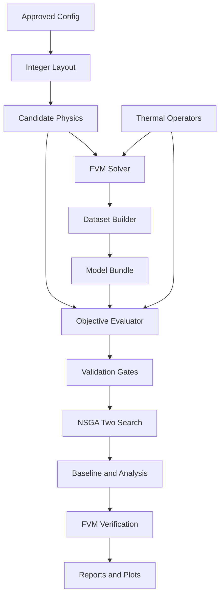
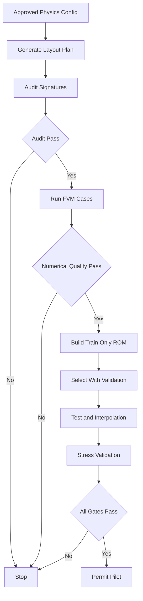
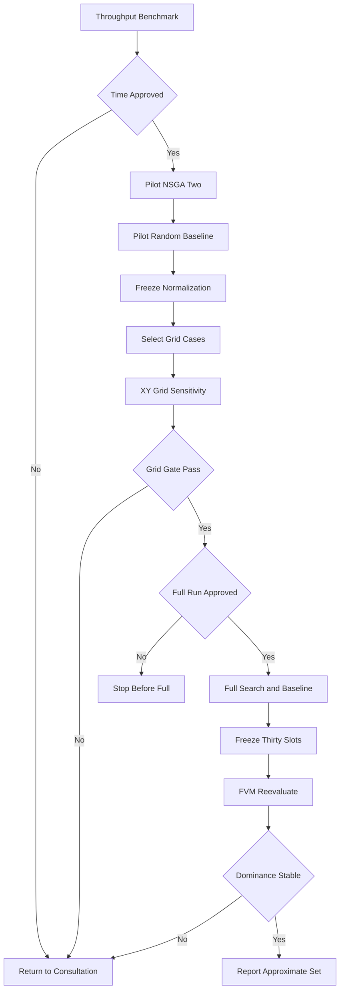
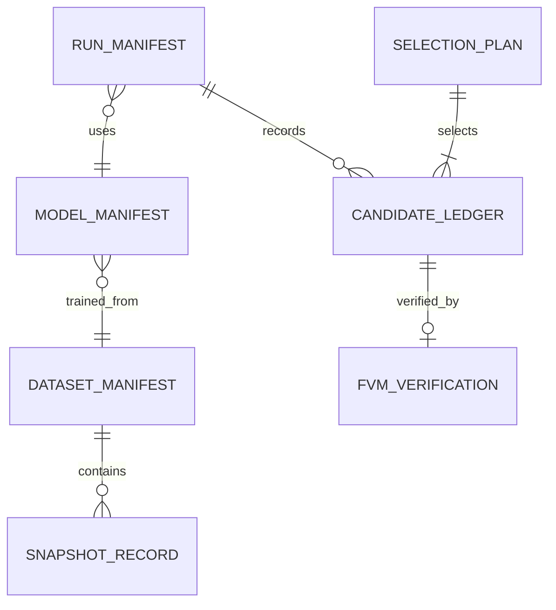
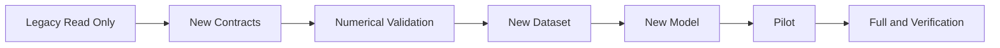

# 多目的TSV最適化 Technical Design

## Overview

**Purpose**: 本機能は、4×4整数TSV配置について、物理的に整合した`Tmax`・`gmax`評価、POD-RBF ROM、2目的・3目的NSGA-II、同予算random baseline、代表候補FVM再評価を、fail-closedな一つの研究pipelineとして提供する。

**Users**: 熱設計研究者と数値解析品質保証担当者が、新しいdatasetの生成、ROM妥当性判定、pilot/full探索、FVM再評価、学会用図表の根拠確認に使用する。

**Impact**: 現行FVMの面係数を一般の非一様・異材面に成立する直列熱抵抗式へ統一し、連続密度・単目的GA中心の旧pipelineから、整数countsをcanonical入力とする多目的pipelineへ移行する。旧artifactは変更せず`LEGACY_UNVERIFIED`として保存する。

### Goals

- FVMと目的評価器が同一の面コンダクタンス演算子を使い、全物理セルの`Tmax`と材料側離散`gmax`を候補固有に評価する。
- 444通常配置と21 stress配置を、split非重複・署名付き・再現可能なdatasetとして構成する。
- ROMの値精度、順位、本数内挿、配置外挿、xy二格子感度を三値以上の品質状態で判定する。
- 固定本数2目的と可変本数3目的を同じ整数NSGA-II枠組みで探索し、同一論理評価予算のrandom baselineと比較する。
- ROM点、FVM点、選定slot、品質状態、全IDを追跡可能な結果表と図を生成する。

### Non-Goals

- MGDAまたはε制約法を主探索へ追加すること。
- 真のパレートフロント、大域最適性、連続場の厳密最大勾配、3次元格子独立性を保証すること。
- POD-RBF以外のROM、信号TSV、配線長、応力、製造コストを追加すること。
- 将来のTSV直径10 µmに対するpitchまたは格子を決めること。
- 本設計の生成または承認だけを根拠に、FVM、snapshot生成、pilot/full探索を実行すること。

## Boundary Commitments

### This Spec Owns

- 16成分整数countsから実TSV座標、layout signature、候補固有材料場へ至るcanonical変換契約。
- FVMと目的評価器が共有する面コンダクタンス、および`Tmax`・離散`gmax`の評価契約。
- 444通常配置、21 stress配置、OOD診断、split auditのdataset計画。
- POD-RBF ModelBundleと、多目的ROM validation gate。
- 整数NSGA-II、random baseline、論理評価ledger、全履歴archive、正規化、hypervolume、knee、代表点選定。
- xy二格子感度と代表点FVM照合の入力・判定・停止状態。
- 多目的runの候補ledger、manifest、図表data、provenance。

### Out of Boundary

- FVM境界条件、発熱モデル、材料物性値そのものの研究上の変更。
- POD分解とGaussian RBFの数理algorithmの別方式への置換。
- `research-data-contract`、`research-run-provenance`、`numerical-vv`全体の所有。未実装部分とはversion付きadapterで接続する。
- 旧run、旧snapshot、旧model、旧図表の削除、移動、上書き、品質昇格。
- 長時間計算の自動起動、結果に応じた閾値・格子・探索予算の自動変更。

### Allowed Dependencies

- `H2-main-ext/ComponentGenerator` — 整数countsから実座標への決定的展開と物理制約検証。
- `H2-main-ext/ModelBuilder` — 候補固有の材料ID・熱伝導率場と格子幾何の構築。
- `H2-main-ext/ThermalOperators` — 面コンダクタンスとFVM数値診断の単一正本。
- `H2-rom/PipelineData`, `PipelineROM`, `ROMInterpolator` — train-only POD-RBFと全場再構成。
- `H2-rom/SearchOptimizer.dominates` — 支配関係の純粋関数。旧局所探索は使用しない。
- `H2-rom/PipelineReport` — run配下限定出力。新しいmanifest/ledger schemaで拡張する。
- Julia標準ライブラリ`Random`, `Statistics`, `LinearAlgebra`, `SHA`, `Dates`, `DelimitedFiles`と既存依存`Distributions`, `JLD2`, `JSON3`, `Plots`。
- 承認済み`numerical-vv` policy — FVM収束・エネルギー収支・解析試験許容誤差。policy不在時はdataset生成を禁止する。

### Revalidation Triggers

- 面コンダクタンス式、熱伝導率のscalar/anisotropic解釈、接触熱抵抗、格子直交性が変わる。
- 材料ID 2・7、物性、評価mask、温度場のghost配置、flatten順序が変わる。
- 4×4、セル上限9、直径40 µm、pitch 80 µm、本数36–60、配置規則versionが変わる。
- snapshot、dataset、ModelBundle、candidate ledgerのschemaまたはsignature算法が変わる。
- ROM入力scaler、POD/RBF API、目的定義ID、validation thresholdが変わる。
- NSGA-II演算子、rate、repair/tie-break、seed plan、予算計数規則が変わる。
- pilot正規化範囲、hypervolume参照点、代表点選定規則が変わる。

## Architecture

### Existing Architecture Analysis

- `H2-main-ext`は配置、model構築、solverを持つが、面係数がsolver kernelへ重複し、収束失敗を警告だけで継続する経路がある。
- `H2-rom`はPOD-RBF全場再構成と支配判定を再利用できるが、旧`grad3d_max`、部分行`TmaxEvaluator`、実数単目的`GaOptimizer`は新要件と非互換である。
- 現行snapshotとprovenanceは候補同一性、grid signature、数値品質を完全には束縛しない。
- したがって旧moduleへ条件分岐を積み増さず、共有数値演算子、整数dataset、多目的評価、NSGA-II、validation/reportを明確な境界として追加する。

### Architecture Pattern & Boundary Map

**Selected pattern**: contract-first staged pipeline。各stageはversion付きartifactを受け、前段の品質gateが`PASS`の場合だけ次へ進む。依存方向は次の順序に固定する。

`Types and Contracts → Physics and Layout → Dataset and ROM → Evaluation and Validation → Search and Analysis → Verification and Report`



**Key decisions**:

- 二つの物理セルを結ぶ内部面のコンダクタンスは`ThermalOperators.internal_face_conductance`だけで計算する。外部境界面は、境界条件ごとの専用演算子で扱い、ghost cellを内部面式へ渡さない。
- canonical設計入力は整数countsであり、連続`mu`はROM内部表現としてのみ扱う。
- candidate評価は温度場だけでなく候補固有材料場とsignatureを含む`FieldBundle`を要求する。
- quality gateは`PASS`以外で自動停止し、penaltyやfallbackで隠さない。
- physical cacheと論理runの評価budgetは別aggregateとして記録する。

### Technology Stack

| Layer | Choice / Version | Role | Notes |
|---|---|---|---|
| Runtime | Julia 1.10+ | 全moduleとdriver | 実runではversionとManifest hashを記録 |
| Physics | `H2-main-ext`, `LinearAlgebra` | FVM、材料場、面演算子 | solverと評価器で演算子共有 |
| Sampling | `Random`, `Distributions` | seed別Dirichlet生成 | RNGを引数注入しglobal RNG禁止 |
| ROM | 既存POD-RBF、`JLD2` | ModelBundleと全場再構成 | 新しいROM方式は追加しない |
| Storage | `JSON3`, `JLD2`, TSV | manifest、field、ledger | schema version必須 |
| Search | 専用Julia実装 | NSGA-II、baseline、HV | 新規packageなし |
| Visualization | `Plots` | 2D・3D散布図 | data表を図と同時保存 |

## Approval-Gated Design Parameters

以下は要件でdesign提示を要求された設計案である。本`design.md`の本人承認によって凍結し、数値実験中には変更しない。`numerical-vv`が異なる値を提示する場合は、理由と影響を示して再承認する。

| Parameter | Proposed value / rule | Rationale |
|---|---|---|
| 面コンダクタンス試験 | `rtol=1e-12`, `atol=0` | 同じFloat64代数式の独立計算比較 |
| 解析勾配試験 | `rtol=1e-10`; `atol=100*eps(Float64)*g_scale` K/m | zero場と大きい勾配scaleを同じ規則で扱う |
| FVM収束候補 | 最終相対残差`<=1e-6`かつ`converged=true` | 現行solver規約を明示化。numerical-vv承認が優先 |
| エネルギー収支候補 | `abs(Qin-Qout)/max(abs(Qin),abs(Qout),eps(Float64)) <= 1e-4` | 無次元balance。numerical-vv承認が優先 |
| ROM hyperparameter選択 | validationの本数別・目的別正規化MAEの最大値を最小化 | 片方の目的だけに偏らないminimax規則 |
| ROM選択tie | POD mode昇順、lambda降順、epsilon昇順 | 小さいmodelと強い正則化を優先 |
| NSGA-II交叉率 | offspring pair当たり0.9 | pilot前の初期提案 |
| NSGA-II突然変異率 | offspring当たり0.2、発火時は1操作 | 16整数変数で過度な多点変異を避ける初期提案 |
| 交叉 | 16成分の二点交叉後に決定的repair | 整数性を維持し、固定/可変本数を同じ骨格で扱う |
| 2目的mutation | feasibleなsourceからdestinationへの1本移送 | 総数を厳密に保存 |
| 3目的mutation | feasibleな移送・追加・削除から一様選択 | 本数と配置の両方を動かす |
| repair tie | parental meanからの過不足、次にセルindex昇順 | 同じ親・seedから同じ子を得る |
| 数値tie | 正規化目的で`rtol=1e-12`, `atol=0` | 極値・距離の機械的同点判定 |
| throughput候補数 | 200候補を逐次評価 | full population 1世代相当、100–1000範囲内 |

解析勾配試験では、対象となる製造解温度場の全物理セルについて`T_scale = max(max(abs.(T)), 1 K)`とする。`d_min`は、評価対象の全軸について隣接する二つの物理セル中心間距離の最小正値[m]とする。`g_scale = max(1 K/m, T_scale/d_min)`であり、温度と距離の単位変換後に上表の絶対許容誤差を評価する。これにより`T_scale`、`d_min`の参照範囲と単位を一意にする。

### Deterministic NSGA-II operator protocol

- 各論理runは専用RNGを1個持ち、候補集合は必ずcell index昇順に整列してから乱数indexを引く。global RNG、集合iteration順、並列完了順へ依存しない。
- 二点交叉はoffspring pairごとに交叉発火Bernoulliを1回引く。発火時は境界`1:15`から異なる2点を一様・非復元で順に引き、昇順を`a < b`として成分`a+1:b`を交換する。不発火時は親を複製する。repairは乱数を消費しない。
- 固定本数repairは親平均`m_i=(p1_i+p2_i)/2`と目標総数`N`を受ける。総数超過時は`n_i>0`のうち`n_i-m_i`最大、同点はcell index最小の成分を1減らす。不足時は`n_i<9`のうち`m_i-n_i`最大、同点はcell index最小の成分を1増やす。総数一致まで再計算し、eligible成分がなければ`RepairFailure`とする。
- 可変本数repairの目標総数は交叉直後の総数を`clamp(sum(n), 36, 60)`した値とし、上と同じ逐次規則で0..9と総数を満たす。親平均は同じ定義を使う。
- mutationはoffspringごとに発火Bernoulliを1回引く。2目的では、発火時に`n_i>0`のsourceを一様選択し、次に`j != i && n_j<9`のdestinationを一様選択して1本移送する。3目的では、固定順`(:transfer, :add, :remove)`から現在feasibleな操作だけを抽出して一様選択し、transferはsource→destination、addは`n_i<9`、removeは`n_i>0`の昇順集合から一様選択する。add/removeは総数36..60を越える場合feasible集合へ入れない。1回の発火でちょうど1操作とする。
- binary tournamentは母集団indexから異なる2個を一様・非復元で引き、rank昇順、crowding distance降順、layout signature昇順で勝者を決める。各乱数drawの順序は交叉発火、cut 1、cut 2、子1 mutation、子2 mutationとする。

### Stress rule score proposal

密度セルをrow-majorのindex 1–16で固定する。各規則は目標配分`target_r(N)`を作り、候補`n`を`score_r(n)=sum((n_i-target_i)^2)`の昇順、同点はcountsの辞書順で並べる。既出signatureは除外し、次順位を採る。発熱量`P_i`は承認済み`PhysicsContract.heat_map_hash`が指す固定baseline発熱mapを各密度セル領域で体積積分した非負値であり、探索候補から再計算しない。発熱mapが欠落するかhash不一致ならstress生成を停止し、別mapへfallbackしない。

| Rule | Target construction |
|---|---|
| 一様 | 各セル`N/16`の連続目標 |
| 発熱比例 | 固定baseline発熱mapを非負正規化して`N`倍 |
| 高発熱優先greedy | 発熱降順、同熱量はcell index昇順で上限9まで充填 |
| 低発熱優先greedy | 発熱昇順、同熱量はcell index昇順で上限9まで充填 |
| 中心集中 | cell中心からchip中心までの距離昇順、同距離はcell index昇順で充填 |
| 周辺・隅集中 | chip中心距離降順、同距離はcell index昇順で充填 |
| checkerboard | row+columnが偶数の8セルをmask A、奇数の8セルをmask Bとし、各maskについて対象セルを`N/8`、対象外を0とする二つの連続目標を作る。checkerboard scoreは二つの二乗誤差の小さい方とし、同値ならmask Aを先にする |

各目標の候補列は、16セルを順に処理するbounded k-best動的計画法で厳密に作る。状態`(i,s)`は先頭`i`セルへ合計`s`本を割り当てたprefixのうち、累積二乗誤差、次にprefix辞書順で上位`K=21`件だけを保持する。遷移は次セルの本数`0:9`を昇順に試し、最終状態`(16,N)`を同じ順序で返す。checkerboardはmask AとBそれぞれの上位21件をunionし、`(checkerboard score, winning mask A before B, counts lexicographic)`で重複除去・整列する。stress caseは`N=36,48,60`の順、各N内では表の規則順に処理し、それ以前に採用済みのlayout signatureを除く最上位を1件採用する。異なる総数のcountsは一致しないため、同じNで先行する候補は最大6件であり、`K=21`内に未採用候補がなければ生成を失敗させる。この有限算法と`K`はdesign承認対象であり、生成時に変更しない。

## File Structure Plan

### Directory Structure

```text
H2-main-ext/src/
├── ThermalOperators/
│   ├── ThermalOperators.jl       # 公開moduleとexport
│   ├── Types.jl                  # GridGeometry3D, NumericalPolicy, SolveQuality
│   ├── Conductance.jl            # internal_face_conductanceの単一正本
│   ├── BoundaryOperators.jl      # Dirichlet/Neumann/Robin外部境界熱流
│   └── EnergyBalance.jl          # 境界熱流と収支診断
├── ComponentGenerator/
│   └── IntegerLayout.jl          # counts展開、canonical座標、signature
└── SnapshotContract/
    ├── SnapshotContract.jl       # schema versionと保存読込契約
    └── Types.jl                  # SnapshotIdentity, PhysicsMetadata

H2-rom/src/
├── LayoutDataset/
│   ├── LayoutDataset.jl          # module入口
│   ├── Types.jl                  # LayoutCase, DatasetPlan, StressRule, Audit
│   ├── Projection.jl             # DP整数射影
│   ├── Generator.jl              # 通常・stress生成
│   └── OOD.jl                    # layout OOD model
├── MultiobjectiveEvaluation/
│   ├── MultiobjectiveEvaluation.jl
│   ├── Types.jl                  # FieldBundle, ObjectiveEvaluation, ModelBundle
│   ├── FieldAdapter.jl           # FVM/ROM場の共通物理cell view
│   ├── Objectives.jl             # Tmaxとgmax
│   └── CandidateEvaluator.jl     # countsから候補固有評価
├── MultiobjectiveValidation/
│   ├── MultiobjectiveValidation.jl
│   ├── Types.jl                  # GateStatusと各report
│   ├── ROMValidation.jl          # split、stress、error band
│   └── GridSensitivity.jl        # xy二格子判定
├── NSGA2Optimizer/
│   ├── NSGA2Optimizer.jl
│   ├── Types.jl                  # config、candidate、state、ledger、archive
│   ├── Ranking.jl                # rankとcrowding distance
│   ├── Operators.jl              # crossover、mutation、repair
│   └── Engine.jl                 # generation loop
├── OptimizationAnalysis/
│   ├── OptimizationAnalysis.jl
│   ├── Baseline.jl               # 同予算random探索
│   ├── Normalization.jl          # pilot範囲freeze
│   ├── Hypervolume.jl            # 2D/3D HV
│   └── Selection.jl              # knee、maximin、30 slot
├── MultiobjectiveWorkflow/
│   ├── MultiobjectiveWorkflow.jl # gate付きstage coordinator
│   ├── Types.jl                  # WorkflowConfigとstate
│   └── Provenance.jl             # manifestとcandidate ledger
└── MultiobjectiveReport/
    ├── MultiobjectiveReport.jl
    ├── Tables.jl                 # TSV/JSON出力
    └── Plots.jl                  # 2D/3D図

H2-main-ext/test/
├── test_thermal_operators.jl
├── test_objective_analytic_fields.jl
├── test_integer_layout.jl
└── test_snapshot_contract.jl

H2-rom/test/
├── test_layout_dataset.jl
├── test_multiobjective_evaluation.jl
├── test_multiobjective_validation.jl
├── test_nsga2_optimizer.jl
├── test_optimization_analysis.jl
└── test_multiobjective_workflow.jl
```

### Modified Files

- `H2-main-ext/src/common.jl` — 旧`λf`の直接利用を廃止し、互換名が必要なら`ThermalOperators`へ委譲する。
- `H2-main-ext/src/NonUniform.jl` — 物理セル間の全内部面係数を`internal_face_conductance`へ統一する。外部境界係数は既存の境界条件APIを`BoundaryOperators`へ集約し、収束結果を型で返す。
- `H2-main-ext/src/ComponentGenerator/ComponentGenerator.jl` — 整数配置APIと署名をexportする。
- `H2-main-ext/src/ComponentGenerator/Layout.jl` — 既存連続density経路は保持し、新整数経路と混同しない。
- `H2-main-ext/src/ComponentGenerator/Validator.jl` — canonical integer layoutの検証をFVM入口から迂回不能にする。
- `H2-main-ext/src/ModelBuilder/ModelBuilder.jl` — 検証済みlayoutと`GridGeometry3D`から候補物理場を返す。
- `H2-main-ext/src/heat3ds.jl` — version付きsnapshot identity、収束、energy balanceを保存し、不合格をfail closedにする。
- `H2-rom/src/PipelineData/types.jl`, `loader.jl` — dataset/split/snapshot/layout/grid IDと品質状態を保持する。
- `H2-rom/src/PipelineROM/types.jl`, `builder.jl` — ModelBundle metadata、二目的validation選択、限定行評価禁止を追加する。
- `H2-rom/src/SearchOptimizer/pareto.jl` — 支配純粋関数は保持し、有限性検証を強化する。
- `H2-rom/src/PipelineReport/` — run境界を維持し、新manifest/ledger writerを接続する。
- `H2-rom/Project.toml`, `H2-main-ext/Project.toml` — 標準ライブラリ`SHA`を明示する場合だけ更新し、新規外部packageは追加しない。

### Read Only Legacy Inputs

- `runs/paper_final_20260824T0140JST/`
- 旧424件dataset、旧`grad3d_max`、旧ε探索、旧単目的GA artifacts

## System Flows

### Dataset and ROM flow



### Search and verification flow



## Requirements Traceability

| Requirement IDs | Summary | Components / Contracts | Flow |
|---|---|---|---|
| 1.1, 1.2, 1.3, 1.4, 1.5, 1.6, 1.7, 1.8 | 基準条件と整数設計入力 | IntegerLayout, SnapshotContract, WorkflowConfig | Dataset |
| 2.1, 2.2, 2.3, 2.4, 2.5, 2.6 | 全物理セル`Tmax` | FieldBundle, ObjectiveEvaluator | Dataset and Search |
| 3.1, 3.2, 3.3, 3.4, 3.5, 3.6, 3.7, 3.8, 3.9, 3.10, 3.11 | 面流束整合`gmax` | ThermalOperators, ObjectiveEvaluator | Dataset and Search |
| 4.1, 4.2, 4.3, 4.4, 4.5, 4.6, 4.7, 4.8, 4.9 | 解析場検証と数値gate | NumericalPolicy, analytic tests, WorkflowGate | Dataset gate |
| 5.1, 5.2, 5.3, 5.4, 5.5, 5.6, 5.7, 5.8, 5.9, 5.10, 5.11, 5.12 | dataset、stress、OOD | LayoutDataset, DatasetAudit, ModelBundle | Dataset |
| 6.1, 6.2, 6.3, 6.4, 6.5, 6.6, 6.7, 6.8, 6.9, 6.10 | ROM妥当性 | MultiobjectiveValidation | ROM gate |
| 7.1, 7.2, 7.3, 7.4, 7.5, 7.6, 7.7 | xy二格子感度 | GridSensitivityResult, VerificationCoordinator | Grid gate |
| 8.1, 8.2, 8.3, 8.4, 8.5, 8.6, 8.7 | 固定本数2目的NSGA-II | NSGA2Optimizer, ObjectiveCache, ParetoArchive | Search |
| 9.1, 9.2, 9.3, 9.4, 9.5, 9.6, 9.7, 9.8 | 可変本数3目的NSGA-II | NSGA2Optimizer, DomainDiagnostic | Search |
| 10.1, 10.2, 10.3, 10.4, 10.5, 10.6, 10.7, 10.8, 10.9, 10.10, 10.11, 10.12, 10.13, 10.14 | 予算、再現性、HV、knee | WorkflowConfig, Normalization, Hypervolume, Selection | Search and Analysis |
| 11.1, 11.2, 11.3, 11.4, 11.5, 11.6, 11.7 | 同予算baseline | BaselineRunner, EvaluationLedger | Search and Analysis |
| 12.1, 12.2, 12.3, 12.4, 12.5, 12.6, 12.7, 12.8, 12.9, 12.10, 12.11, 12.12, 12.13 | 30 slotとFVM再評価 | RepresentativeSelector, VerificationCoordinator | Verification |
| 13.1, 13.2, 13.3, 13.4, 13.5, 13.6 | 目的相関 | CorrelationReport | Validation and Report |
| 14.1, 14.2, 14.3, 14.4, 14.5, 14.6, 14.7, 14.8 | 可視化、来歴、旧spec境界 | MultiobjectiveReport, Provenance | Report |

## Components and Interfaces

| Component | Layer | Intent | Requirements | Dependencies |
|---|---|---|---|---|
| ThermalOperators | Physics | 面係数と数値品質の正本 | 3.2–3.5, 4.6–4.9 | Grid geometry P0 |
| IntegerLayout | Physics | countsから検証済み実配置 | 1.2–1.7 | ComponentGenerator P0 |
| LayoutDataset | Data | 通常・stress・OOD・audit | 5.1–5.12 | IntegerLayout P0 |
| ObjectiveEvaluator | Domain | 共通`Tmax`・`gmax`評価 | 2.1–2.6, 3.1–3.11 | ThermalOperators P0 |
| ModelBundleService | ROM | train-only POD-RBFと候補場 | 5.7, 6.1–6.10 | PipelineROM P0 |
| ValidationService | Quality | ROM・stress・grid gate | 4.1–4.9, 6.1–7.7 | ObjectiveEvaluator P0 |
| NSGA2Optimizer | Search | 整数2/3目的探索 | 8.1–10.7 | ModelBundleService P0 |
| OptimizationAnalysis | Analysis | baseline、HV、knee、代表点 | 10.8–12.13 | NSGA2Optimizer P0 |
| WorkflowCoordinator | Runtime | stage遷移と承認停止 | 4.8, 6.9, 7.6, 10.2–10.7, 14.7 | 全gate P0 |
| MultiobjectiveReport | Output | 表、図、来歴、主張境界 | 13.1–14.8 | PipelineReport P1 |

### Physics Layer

#### ThermalOperators

**Contracts**: Service [x] / State [x]

```julia
struct GridGeometry3D
    x_faces::Vector{Float64}
    y_faces::Vector{Float64}
    z_faces::Vector{Float64}
    physical_ranges::NTuple{3,UnitRange{Int}}
    grid_signature::String
end

struct NumericalPolicy
    policy_id::String
    approval_record_id::String
    conductance_rtol::Float64
    gradient_rtol::Float64
    solver_relative_residual_max::Float64
    energy_relative_imbalance_max::Float64
    approved::Bool
end

internal_face_conductance(area::Float64, d_p::Float64, d_n::Float64,
                          k_p::Float64, k_n::Float64)::Float64

boundary_heat_rate(bc::BoundaryCondition, face::BoundaryFace,
                   cell_temperature::Float64)::Float64
```

- `internal_face_conductance`のpreconditions: 面積、二つの物理セル中心から共有面までの距離、両セル熱伝導率は有限かつ正、格子は直交、物性はセル内一定scalar。外部ghost、境界温度、境界熱流を入力してはならない。
- Postconditions: `A/(d_p/k_p+d_n/k_n)`と同値な有限正値を返す。
- Invariants: 外向き単位法線`n`に対する熱流率`Q_b = integral(q dot n)dA`を正とする。Dirichletでは現行係数`G_b`を用いて`Q_b=G_b(T_P-T_b)`、指定外向きNeumannでは`Q_b=q_out A`、Robinでは現行FVM離散化を保存して`Q_b=h A (T_P-T_inf)`とする。`A,h`は正、`q_out`の単位はW/m2とする。`BoundaryOperators`は現行境界係数、符号、集計、重複除去を一元化するが、境界離散化を変更しない。FVM solverと`gmax`は物理セル間の内部面について`internal_face_conductance`以外の面係数式を持たない。
- Energy balance: 正の体積発熱積分を`Q_gen`、全外部境界面の熱流率を`Q_b`として、`Qin = Q_gen + sum(max(-Q_b,0))`、`Qout = sum(max(Q_b,0))`と定義する。相対不均衡は上表の`abs(Qin-Qout)/max(abs(Qin),abs(Qout),eps(Float64))`であり、6面すべてを一度だけ集計する。
- Validation: `approved`は`approval_record_id`が指す外部approval recordとの照合結果から導出し、Bool単独を本人承認の証拠にしない。policyが未承認、収束/energyが不合格ならsnapshot品質を`PASS`にしない。

#### IntegerLayout

```julia
struct IntegerLayoutSpec
    counts::NTuple{16,Int}
    tsv_diameter_m::Float64
    min_pitch_m::Float64
    rule_version::String
end

struct VerifiedLayout
    spec::IntegerLayoutSpec
    coordinates_m::Vector{NTuple{2,Float64}}
    layout_signature::String
    physical_signature::String
end

expand_integer_counts(spec::IntegerLayoutSpec,
                      config::ModelConfig)::VerifiedLayout
```

- countsを再scaleまたはroundしない。
- cell内候補は`(distance2, y_index, x_index)`順。
- 生成数、有限性、実装領域、80 µm pitch、直径、cell上限、必要な総数制約を検証する。

### Data and ROM Layer

#### LayoutDataset

```julia
@enum SplitKind Train Validation Test InterpolationTest Stress

struct LayoutCase
    snapshot_id::String
    case_id::String
    split::SplitKind
    split_id::String
    counts::NTuple{16,Int}
    total_count::Int
    seed::Int
    generation_index::Int
    layout_signature::String
    physical_signature::String
end


project_integer_layout(p::NTuple{16,Float64}, total::Int)::NTuple{16,Int}
generate_dataset(plan::DatasetPlan)::Vector{LayoutCase}
audit_dataset(cases::Vector{LayoutCase})::DatasetAudit
```

- 射影はDPで二乗誤差最小、同値はcounts辞書順。
- split別RNGを引数で受け、snapshot/layout/physical重複をfail closedで拒否する。
- `LEGACY_UNVERIFIED`入力をquality昇格させない。
- OOD modelはtrainの`counts/N`だけでfitし、validation 95 percentileを凍結する。

#### ObjectiveEvaluator

```julia
struct PhysicsContract
    physics_config_id::String
    physics_config_hash::String
    material_table_hash::String
    heat_map_hash::String
    layout_rule_version::String
    tsv_diameter_m::Float64
    min_pitch_m::Float64
    silicon_material_ids::NTuple{2,UInt8}
    expected_silicon_conductivity_W_mK::NTuple{2,Float64}
end

struct FieldIdentity
    case_id::String
    layout_signature::String
    grid_signature::String
    physics_contract_hash::String
    material_field_signature::String
    conductivity_field_signature::String
    objective_definition_id::String
end


struct FieldBundle
    counts::NTuple{16,Int}
    temperature::Array{Float64,3}
    material_id::Array{UInt8,3}
    conductivity::Array{Float64,3}
    geometry::GridGeometry3D
    identity::FieldIdentity
    physics::PhysicsContract
    temperature_unit::Symbol
end


struct ObjectiveEvaluation
    tmax::Float64
    gmax::Float64
    total_count::Int
    tmax_index::CartesianIndex{3}
    tmax_coordinate_m::NTuple{3,Float64}
    gmax_index::CartesianIndex{3}
    gmax_coordinate_m::NTuple{3,Float64}
    gmax_material_id::UInt8
    gmax_components::NTuple{3,Float64}
    identity::FieldIdentity
    temperature_unit::Symbol
    gradient_unit::Symbol
end


evaluate_objectives(field::FieldBundle)::ObjectiveEvaluation
```

- 全物理セルを走査し、partial-row evaluatorを受け付けない。
- `gmax`は材料ID 2・7だけを対象とし、内部異材面を含め、外部面依存cellを除外する。
- `ObjectiveEvaluation.total_count`は`sum(field.counts)`だけから生成する。countsは16成分、各0..9、layout signatureおよび候補固有材料場と一致することを検証し、材料IDセル数からTSV本数を推定しない。
- shape、identity、単位、有限性、正の幾何/物性を入口で検証する。`silicon_material_ids`が材料table上の意図したSi層を指すこと、各IDの熱伝導率が契約値と一致すること、材料場・熱伝導率場のsignatureが候補固有配列と一致することも検証し、不一致時は評価しない。

#### ModelBundleService

```julia
struct ModelBundle
    model::RomModel
    model_id::String
    dataset_id::String
    split_ids::Vector{String}
    grid_signature::String
    physics::PhysicsContract
    objective_definition_id::String
    train_budgets::NTuple{3,Int}
    train_layout_ratios::Matrix{Float64}
    ood_threshold::Float64
end


predict_candidate(bundle::ModelBundle,
                  counts::NTuple{16,Int},
                  factory::CandidatePhysicsFactory)::ObjectiveEvaluation
```

- POD、平均場、scaler、RBFはtrainだけから学習する。
- hyperparameter候補の比較はvalidationだけを使い、test/stressを参照しない。
- `CandidatePhysicsFactory`は`ModelBundle.physics`と同一hashの設定だけを受理する。候補countsから材料ID場と熱伝導率場を毎候補生成し、そのsignatureを検証してからROM全温度場と組み合わせ、同じObjectiveEvaluatorへ渡す。factory解決をglobal状態や暗黙既定値に委ねない。

### Quality Layer

#### ValidationService

```julia
@enum GateStatus PASS FAIL INCONCLUSIVE UNSUPPORTED

struct ValidationGate
    status::GateStatus
    gate_id::String
    reasons::Vector{String}
    evidence_ids::Vector{String}
end


validate_rom(bundle::ModelBundle, dataset::DatasetView)::ValidationReport
validate_grid(cases::Vector{GridPair})::GridSensitivityReport
```

- ROM reportはsplit、本数、目的ごとのMAE、RMSE、最大絶対誤差、Spearman、設計幅正規化MAEを持つ。
- 設計幅0、定数順位、標本不足、非有限相関は`INCONCLUSIVE`。
- stress単点比0.2以上または分母不定は`UNSUPPORTED`。
- 経験的誤差幅は学習本数、6 interpolation水準、その他中間本数の規則を区別する。
- xy二格子は固定本数ごとの3点だけで設計幅を計算し、一様配置からの改善符号も保持する。

### Search and Analysis Layer

#### NSGA2Optimizer

```julia
struct NSGA2Config
    objectives::Int
    fixed_total::Union{Nothing,Int}
    population_size::Int
    generations::Int
    crossover_rate::Float64
    mutation_rate::Float64
    seed::Int
    phase::Symbol
end


struct EvaluatedCandidate
    counts::NTuple{16,Int}
    evaluation::ObjectiveEvaluation
    layout_signature::String
    rank::Int
    crowding_distance::Float64
end


run_nsga2(config::NSGA2Config,
          evaluator::CandidateEvaluator)::SearchRun
```

- 非支配rankを先、同rankはcrowding distance降順、さらに同点はlayout signature昇順でbinary tournamentする。
- crowding distanceは各目的の端点を`Inf`、設計幅0の目的寄与を0とする。
- fixed repairは総数を厳密保存し、variable repairは36–60へ収める。
- 実行不能候補は評価せず、penalty値でpopulationへ残さない。
- layout signature cache hitと棄却はunique evaluation budgetへ数えない。

#### OptimizationAnalysis

```julia
struct FrozenNormalization
    problem_id::String
    minima::Vector{Float64}
    maxima::Vector{Float64}
    reference::Vector{Float64}
    source_phase::Symbol
end


run_random_baseline(config::BaselineConfig,
                    target_unique_evaluations::Int)::SearchRun
compute_hypervolume(archive::ParetoArchive,
                    norm::FrozenNormalization)::MetricResult
select_representatives(archive::ParetoArchive,
                       plan::SelectionPlan)::Vector{SelectionSlot}
```

- baselineは方式固有streamを使い、対応seed indexだけをpairingする。
- 物理cacheを共有しても論理ledgerは方式・phase・problem・seed別に独立する。
- 正規化範囲はpilot NSGA-IIとbaselineのunionから固定し、clipしない。
- HVは2D/3Dのみ、参照点1.1。範囲外点があれば`INCONCLUSIVE`。
- 30 slotをFVM前に凍結し、一意非劣layout不足はfail closed。

### Runtime and Output Layer

#### WorkflowCoordinator

状態遷移は`PLANNED → NUMERICAL_VERIFIED → DATASET_VERIFIED → ROM_VERIFIED → BENCHMARK_APPROVED → PILOT_COMPLETE → GRID_VERIFIED → FULL_APPROVED → FULL_COMPLETE → FVM_VERIFIED → REPORTED`とする。任意の必須gateがPASS以外なら`STOPPED`へ遷移し、同じrun IDで後段を再開しない。

#### MultiobjectiveReport

- 2目的図は`Tmax–gmax`、N=36/48/60、method、ROM/FVM、支配状態を識別する。
- 3目的図1枚と全目的対2D図3枚を同じcandidate ledgerから生成する。
- labelは「近似パレート集合」または「得られた非劣解候補」に固定する。
- seed別HVとmedian/IQR、独立test相関、stress参考相関、非劣集合条件付き相関を別表にする。
- FVM主張はFVM再評価済みselection slotだけに限定する。

## Data Models

### Aggregate Boundaries



- `DatasetManifest`: split seed、case、signature、snapshot品質を所有する。
- `ModelManifest`: train/validation IDs、POD/RBF設定、objective/grid/physics契約を所有する。
- `RunManifest`: phase/problem/method/seed/config/code revision/quality gateを所有する。
- `CandidateLedger`: counts、目的値、signature、OOD、cache、unique evaluation index、FVM状態を所有する。
- `SelectionPlan`: 30 slotの凍結時刻、規則version、候補IDを所有する。

### Schema Rules

- 全manifestは`schema_version`、content ID、生成元ID、SHA-256を持つ。
- IDは表示名でなくcontentまたはimmutable run identityへ結び付ける。
- finalized run artifactは上書きせず、新run IDを発行する。
- field配列はflatten順、ghost有無、shape、単位、grid signatureを必須とする。
- candidate ledgerはTSVまたはJSONLで追記可能にし、最終化時にhashを固定する。

## Error Handling

| Category | Examples | Response |
|---|---|---|
| Input contract | counts長不正、非有限、signature不一致 | 即時例外、artifact生成なし |
| Physics | 非正面積/距離/k、mask空、非直交条件 | `FAIL`、別差分式へfallback禁止 |
| FVM quality | 未収束、energy不合格、snapshot保存失敗 | datasetへ昇格せずworkflow停止 |
| Dataset | split重複、444/21件不一致、legacy混入 | audit `FAIL` |
| Statistics | 設計幅0、定数順位、標本不足 | `INCONCLUSIVE`、PASS扱い禁止 |
| Stress | 単点比0.2以上 | `UNSUPPORTED`、本探索停止 |
| Search | repair不能、一意archive不足 | 候補棄却または選定fail closed |
| HV | 正規化分母0、正規化値1.1超 | HV `INCONCLUSIVE` |
| Verification | 改善符号・主要支配反転 | 結論保留、ROM妥当性へ戻す |

全errorはrun ID、stage、case/layout signature、error code、原因、保存済みartifact IDを構造化して記録する。研究結果を得るために閾値、格子、予算、目的定義を自動変更しない。

## Testing Strategy

### Unit Tests

- `ThermalOperators`: 等幅同材、等幅異材、非対称異材の独立直列抵抗値、非正入力拒否。外部6面それぞれのDirichlet/Neumann/Robinについて既知の境界熱流、符号、energy balanceを回帰試験する。
- `ObjectiveEvaluator`: 定数場、xyz線形場、非一様z線形場、同k別ID、二材料1D場、mask、符号、最大位置、全cell`Tmax`。
- `ObjectiveEvaluator`: countsの長さ・0..9・総数・layout signature整合を検証し、`total_count == sum(counts)`を確認する。
- `IntegerLayout`: 16整数、0..9、固定/可変総数、cell内tie、80 µm pitch、署名再現性。
- `LayoutDataset`: DP最適性を小問題全列挙と比較、split seed、444/21件、一意性、OOD距離。
- `NSGA2Optimizer`: hand-calculated rank、crowding、tournament、fixed/variable repair、演算子ごとの乱数消費順、境界総数36/60、0/9飽和cell、同点index、seed再現性。
- `OptimizationAnalysis`: 2D/3D HV既知例、knee/arc fallback、maximin、tie-break、ledger計数。

### Integration Tests

- FVM kernelが使う全物理セル間内部面係数と`internal_face_conductance`を同じfixtureで一致確認し、外部境界係数がこのhelperを呼ばないことを確認する。
- snapshot write/read後もtemperature/material/k/geometry/identityが一致し、異signatureを拒否する。
- trainだけでModelBundleを作り、validation選択にtest/stress IDが現れないことを確認する。
- FVM場とROM場を同じObjectiveEvaluatorへ通し、split別validation reportを生成する。
- NSGA-IIとbaselineが同じtarget unique evaluation budgetを独立ledgerで満たす。
- 30 slotをFVM前に凍結し、重複layoutのsolve再利用とslot数/solve数を分離する。

### Workflow and Contract Tests

- 各必須gateの`FAIL`、`INCONCLUSIVE`、`UNSUPPORTED`で後段callbackが一度も呼ばれない。
- 未承認NumericalPolicy、pilot未承認、full未承認で該当stageを起動しない。
- `LEGACY_UNVERIFIED` artifactを新dataset/model/runへ参照すると拒否する。
- 同じconfigとseedからcandidate sequence、archive、図表data hashが一致する。
- requirements ID、schema version、provenance必須列を機械検査する。

### Numerical Validation and Experiments

解析場試験は実装validationであるが、240/480 FVM、444 snapshot、throughput benchmark、pilot/full探索、30 slot FVMは科学的結果を生む数値実験である。各実行は別の承認済みwork-orderとrun IDを要求し、本design承認だけでは実行しない。

## Performance and Scalability

- 一候補ごとにROM全場を再構成して逐次評価し、444ケースの材料場を常駐させない。
- cache keyはmodel ID、objective definition ID、grid signature、physics contract hash、material field signature、conductivity field signature、layout signatureを含める。どれかが異なれば再利用しない。
- 200候補benchmarkはwall time、候補/秒、peak memory、field再構成、physics生成、目的評価の内訳を記録する。
- pilot/full所要時間はcache hitを仮定しない保守値と、実測hit率を用いる観測値を分けて提示する。
- 部分cell、scalar ROM、budget削減、batch変更はbenchmark結果だけで自動採用しない。

## Migration Strategy



- 旧artifactは物理移動せず`LEGACY_UNVERIFIED`を維持する。
- 新schema readerはversion dispatchし、旧readerを黙って新schema扱いしない。
- 新FVM面係数で得たsnapshotは新dataset IDへ保存し、旧温度場と混ぜない。
- rollbackは新runを`STOPPED`として保全することで行い、旧artifactを上書きして戻さない。

## Open Risks and Approval Notes

- `numerical-vv`の正式policyは未生成である。上記候補値を承認しても、実dataset前に独立V&V契約と照合し、不一致なら再承認が必要である。
- ROM hyperparameter候補の具体的なmodes、epsilon、lambda集合は本設計では研究者入力とし、暗黙既定値を置かない。snapshot生成後、学習前に別途提示・承認する。
- NSGA-II rate、stress score、repair/tie-break、throughput 200件は本設計の承認対象である。変更時は探索結果への影響を示して再承認する。
- `PhysicsContract`は発熱map、材料table、配置規則、直径、pitchをcontent hashで束縛する。新しい物性値や発熱条件は同じIDの更新でなく、新contractとして扱う。
- 現行面係数変更は物理結果を変え得るため、旧論文結果との数値一致を移行条件にしない。新しい解析検証と保存則を合格条件にする。
- Robin境界へ半セル伝導抵抗を追加する案は本specでは採用しない。採用する場合は境界数値モデル変更として別要件、本人承認、独立V&V、新baselineを必要とする。
