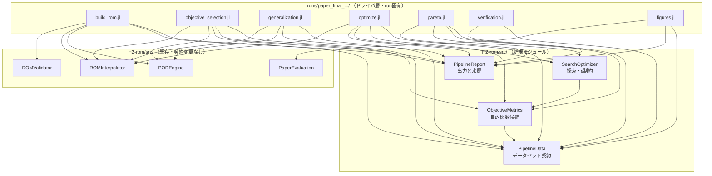
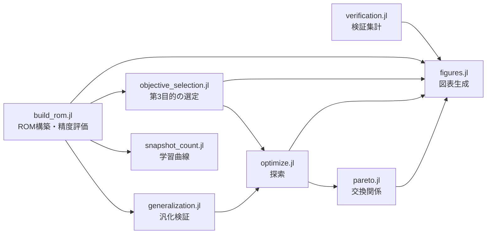
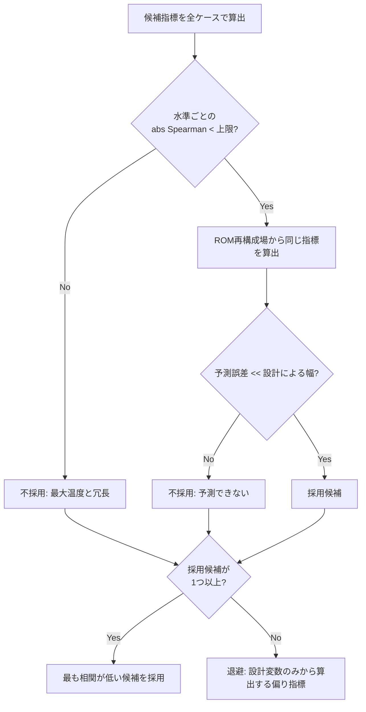

# Technical Design Document

## Overview

**Purpose**: 本設計は、新条件で生成した本番スナップショット群から縮約モデル（ROM）を構築・評価し、TSV本数を連続に扱う多目的最適化を行い、原稿用の図表を生成するパイプラインを定義する。

**Users**: 研究者が締切前の5日間で、Day 2 に ROM 評価と第3目的の選定、Day 3 に最適化と交換関係の提示を行うために使用する。

**Impact**: 既存の旧データセット向け解析スクリプト群（`runs/paper240_asym_v1_20260819T020802JST/*.jl`）は同種の処理を実装済みだが、旧データセットのパスと定数に結び付いている。本設計はこれらを再利用可能なモジュールとして `H2-rom/src/` に切り出し、実行時条件のみを run 固有のドライバから注入する構造に変える。既存モジュール（PODEngine / ROMInterpolator / ROMValidator）は契約を変えずに利用する。

### Goals

- 本番データセット（学習384本 + 内挿テスト40本）に対する ROM 構築・精度評価・汎化検証を実行できる
- 第3目的を、最大温度との独立性と ROM による予測可能性の2条件で機械的に選定できる
- TSV本数を学習水準の範囲内で連続に走査し、最良配置と最悪配置の双方を同定できる
- 重み付けを与えずに交換関係（非劣解集合）を提示できる
- 原稿の全図表を単一のデータセットから生成できる

### Non-Goals

- 有限体積法ソルバの変更およびスナップショットの新規生成（別途 `run_all.sh` が担当済み）
- 発熱源配置を設計変数に加えた最適化（重ね合わせを用いる拡張は学会後）
- 密度マップから TSV 座標への変換アルゴリズムの再設計（学会後）
- 旧データセット向けスクリプトの削除・改変（読み取り専用の参照実装として残す）

## Boundary Commitments

### This Spec Owns

- **データセット契約の解釈**: 計画情報とスナップショット群を読み取り、学習・評価・内挿テストの分割を確定する責任
- **目的関数の値**: 温度場および設計変数から算出される全ての目的関数候補の定義と値
- **第3目的の採否判定**: 独立性と予測可能性の2条件による機械的判定
- **汎化検証の判定**: 水準除外検証と内挿検証の実行と合否判定
- **探索結果**: 各TSV本数における最良設計・最悪設計・一様配置の同定
- **交換関係**: 非劣解集合および ε制約法による探索点
- **図表データ**: 図表の元となる数値データと画像

### Out of Boundary

- **スナップショットの内容**: 温度場・来歴・格子情報は入力として読み取るのみで、生成・改変しない
- **POD 分解および RBF 補間のアルゴリズム**: 既存の `PODEngine` / `ROMInterpolator` が所有する。本設計はこれらを呼び出すのみ
- **FVM の実行**: 再検証用の候補設計は一覧として出力するが、実行そのものは既存のシェルドライバが担当する
- **旧データセットの成果物**: 参照はするが改変しない
- **原稿本文**: 図表と数値データを出力するのみ

### Allowed Dependencies

- `H2-rom/src/PODEngine` — POD 基底と係数の算出（契約変更不可）
- `H2-rom/src/ROMInterpolator` — RBF 補間および温度場再構成（契約変更不可）
- `H2-rom/src/ROMValidator` — 合格判定（**しきい値の既定値のみ変更可**）
- `H2-rom/src/PaperEvaluation` — 特異値減衰プロットとモデルサイズ計測
- 外部パッケージ: `JLD2`, `JSON`, `Statistics`, `LinearAlgebra`, `Printf`, `DelimitedFiles`, `Random`, `Plots`
- 入力: `runs/<run_id>/case_plan.json`, `runs/<run_id>/cases/*/snapshot.jld2`

**制約**: 本設計のモジュールは run 固有のパスを内部に持たない。パスは全て呼び出し側から注入する。

### Revalidation Triggers

- スナップショットの温度場キー名（`theta`）またはゴーストセルの有無が変わったとき
- 計画情報のキー（`cap`, `cases[].{case,name,budget,counts,split,sum_sq,max_cell}`）が変わったとき
- TSV密度マップのセル数（16）またはセル上限（9）が変わったとき
- `PODEngine.compute_pod` または `ROMInterpolator` の返り値の形が変わったとき
- 第3目的として採用する指標が変わったとき（交換関係の図と探索の目的が同時に変わる）

## Architecture

### Existing Architecture Analysis

| 観点 | 現状 |
|---|---|
| 再利用可能モジュール | `H2-rom/src/<Name>/<Name>.jl` に `types.jl` + 実装ファイルを `include` し `export` する構成 |
| 解析スクリプト | `runs/<run_id>/*.jl` に単体スクリプトとして配置。`const HERE = @__DIR__` で自己完結し、`rom/*.txt` と `rom/*.tsv` へ出力 |
| 実行ドライバ | `runs/<run_id>/*.sh` が `xargs -P` で並列実行 |
| データ契約 | `case_plan.json` の `cap` と `cases`、`cases/<name>/snapshot.jld2` の `theta` |
| 保持すべき制約 | 新しい実験出力は `runs/<run_id>/` 内にのみ作る（`agent_policy.md` §4） |

**技術的負債の扱い**: 旧スクリプトは `const BUDGET = 48` のように研究条件をソースに直書きしている。本設計ではこれらを設定構造体に集約し、ドライバから注入する。

### Architecture Pattern & Boundary Map

**選定パターン**: 再利用可能な計算モジュール層 + run 固有の薄いドライバ層。

計算ロジックを `H2-rom/src/` のモジュールに置き、run 固有のパスと研究条件をドライバから注入する。これにより (a) 単体テストが可能になり、(b) 将来の run で再利用でき、(c) 出力は `runs/<run_id>/` に閉じる。



**境界の分離**:

- `PipelineData` はデータセットの読み取りのみを所有し、目的関数も探索も知らない
- `ObjectiveMetrics` は温度場と設計変数から値を出すのみで、採否判定の基準値は呼び出し側が持つ
- `SearchOptimizer` は「設計 → スカラー値」の関数を受け取るのみで、ROM も温度場も知らない
- ドライバは条件の注入と出力先の決定のみを行い、計算ロジックを持たない

### Technology Stack

| Layer | Choice / Version | Role in Feature | Notes |
|-------|------------------|-----------------|-------|
| 言語 / 実行環境 | Julia（`H2-rom/Project.toml` の環境） | 全計算 | 既存環境を変更しない |
| 数値計算 | `LinearAlgebra`, `Statistics` | POD・相関・統計 | 標準ライブラリ |
| 入出力 | `JLD2`, `JSON`, `DelimitedFiles` | スナップショット・計画情報・結果表 | 既存の入出力形式を踏襲 |
| 作図 | `Plots` | 図表生成 | `GKSwstype=nul` を実行時に設定 |
| 乱数 | `Random`（`MersenneTwister`） | 学習曲線の部分集合、探索の初期設計 | シードを記録して再現性を担保 |
| 並列実行 | `xargs -P`（シェル） | FVM 実行ドライバ | 本設計の範囲外（既存） |

## File Structure Plan

### Directory Structure

```
H2-rom/src/
├── PipelineData/                 # 新規: データセット契約の解釈
│   ├── PipelineData.jl           # モジュール定義と export
│   ├── types.jl                  # DatasetSpec, CaseRecord, LoadedDataset
│   └── loader.jl                 # 計画情報とスナップショットの読み取り、分割の確定
├── ObjectiveMetrics/             # 新規: 目的関数候補の算出
│   ├── ObjectiveMetrics.jl
│   ├── types.jl                  # MetricSpec, MetricValues, SelectionVerdict
│   ├── field_metrics.jl          # 温度場から算出する候補（勾配系）
│   ├── design_metrics.jl         # 設計変数のみから算出する候補（偏り系）
│   └── selection.jl              # 独立性・予測可能性の2条件による採否判定
├── SearchOptimizer/              # 新規: 探索と交換関係
│   ├── SearchOptimizer.jl
│   ├── types.jl                  # SearchConfig, SearchResult, ParetoSet
│   ├── local_search.jl           # 多点スタート最急降下（最小化・最大化）
│   ├── budget_sweep.jl           # TSV本数の走査
│   └── pareto.jl                 # 非劣解集合と ε制約法
└── PipelineReport/               # 新規: 出力と来歴
    ├── PipelineReport.jl
    ├── types.jl                  # RunProvenance
    └── writer.jl                 # テキスト表・TSV・来歴の書き出し

runs/paper_final_20260824T0140JST/   # ドライバ層（run固有・出力先）
├── common.jl                     # 本 run の条件定義とモジュールのロード
├── build_rom.jl                  # ROM構築と精度評価（Req 1, 2）
├── snapshot_count.jl             # 学習曲線・複数シード（Req 3）
├── objective_selection.jl        # 第3目的の選定（Req 4）
├── generalization.jl             # 水準除外検証・内挿検証（Req 5）
├── optimize.jl                   # 探索（Req 6）
├── pareto.jl                     # 交換関係（Req 7）
├── verification.jl               # 検証結果の集計（Req 8）
├── figures.jl                    # 図表生成（Req 9）
├── run_analysis.sh               # 上記を順に実行するドライバ
└── rom/                          # 出力先（テキスト表・TSV・PNG）
```

### Modified Files

- `H2-rom/src/ROMValidator/evaluator.jl` — `judge_accuracy` のしきい値の既定値を、配置効果の幅より小さい値に変更し、しきい値が幅以上のときに警告を返せるようにする（Req 2.3, 2.4）
- `H2-rom/Project.toml` — 新規モジュールが追加パッケージを必要とする場合のみ更新（現時点では不要の見込み）

### 参照のみ（改変しない）

- `runs/paper240_asym_v1_20260819T020802JST/*.jl` — 移植元の参照実装
- `runs/fig_support_20260824T0040JST/` — 検証集計の入力

## System Flows

### 解析全体の依存関係



`build_rom.jl` が ROM モデルと精度評価を確定し、`objective_selection.jl` が第3目的を確定する。探索は両方の結果に依存する。`verification.jl` は補助データセットのみに依存するため独立に実行できる。

### 第3目的の選定フロー



判定は2条件の論理積であり、片方でも満たさない候補は不採用とする。全候補が不採用の場合、温度場を使わない偏り指標に退避する（Req 4.6）。この退避先は予測誤差がゼロであるため、常に採用可能である。

## Requirements Traceability

| Requirement | Summary | Components | Interfaces | Flows |
|---|---|---|---|---|
| 1.1 | 学習分割のみで ROM 構築 | PipelineData, build_rom.jl | `load_dataset`, `split_indices` | 解析全体 |
| 1.2 | holdout の誤差指標 | build_rom.jl | `evaluate_accuracy` | 解析全体 |
| 1.3 | 4モデルのベースライン比較 | build_rom.jl | `baseline_models` | 解析全体 |
| 1.4 | interp 分割を学習・評価から除外 | PipelineData | `split_indices` | 解析全体 |
| 1.5 | スナップショット欠落で中止 | PipelineData | `load_dataset` | エラー処理 |
| 1.6 | 出力先を run 内に限定 | PipelineReport | `RunProvenance`, `write_table` | — |
| 2.1 | 水準ごとの最大温度の幅 | build_rom.jl | `per_budget_spread` | 解析全体 |
| 2.2 | 誤差と幅の対比判定 | ROMValidator, build_rom.jl | `judge_accuracy` | 解析全体 |
| 2.3 | しきい値を外部指定 | ROMValidator | `judge_accuracy` | — |
| 2.4 | しきい値が幅以上なら警告 | ROMValidator | `judge_accuracy` | エラー処理 |
| 2.5 | 水準ごとの順位相関と regret | build_rom.jl | `optimization_metrics` | 解析全体 |
| 2.6 | 全水準集計と水準別集計の区別 | PipelineReport | `write_table` | — |
| 3.1 | 部分集合を段階的に増やす | snapshot_count.jl | `learning_curve` | 解析全体 |
| 3.2 | 複数シードで代表値とばらつき | snapshot_count.jl | `learning_curve` | 解析全体 |
| 3.3 | Tmax誤差と L2 誤差を併記 | snapshot_count.jl | `learning_curve` | 解析全体 |
| 3.4 | 部分集合の選び方を再現可能に | PipelineReport | `RunProvenance` | — |
| 4.1 | 温度場から複数の偏り指標 | ObjectiveMetrics | `compute_field_metrics` | 第3目的の選定 |
| 4.2 | 水準ごとの相関と幅 | ObjectiveMetrics | `metric_statistics` | 第3目的の選定 |
| 4.3 | 独立性の条件 | ObjectiveMetrics | `select_third_objective` | 第3目的の選定 |
| 4.4 | 予測可能性の条件 | ObjectiveMetrics | `select_third_objective` | 第3目的の選定 |
| 4.5 | 実測場と再構成場の比較 | ObjectiveMetrics, objective_selection.jl | `compare_metric_prediction` | 第3目的の選定 |
| 4.6 | 全不採用時は設計変数由来へ退避 | ObjectiveMetrics | `select_third_objective` | 第3目的の選定 |
| 4.7 | 全候補の判定結果を出力 | ObjectiveMetrics, PipelineReport | `SelectionVerdict` | 第3目的の選定 |
| 5.1 | 中間水準を除外して学習 | generalization.jl | `holdout_budget` | 解析全体 |
| 5.2 | 除外水準の誤差を対比 | generalization.jl | `holdout_budget` | 解析全体 |
| 5.3 | interp 分割の誤差を算出 | generalization.jl | `interp_check` | 解析全体 |
| 5.4 | 学習水準の誤差と対比 | generalization.jl | `interp_check` | 解析全体 |
| 5.5 | 倍率超過で警告 | generalization.jl | `interp_check` | エラー処理 |
| 6.1 | 各TSV本数で独立に探索 | SearchOptimizer | `sweep_budgets` | 解析全体 |
| 6.2 | 最小化と最大化の双方 | SearchOptimizer | `multi_start_descent` | 解析全体 |
| 6.3 | 最良・最悪・一様の出力 | SearchOptimizer | `SearchResult` | 解析全体 |
| 6.4 | 学習範囲外を除外 | SearchOptimizer | `sweep_budgets` | 解析全体 |
| 6.5 | 再検証候補の一覧 | optimize.jl | `stage_candidates` | 解析全体 |
| 6.6 | 相異なる解の個数 | SearchOptimizer | `SearchResult` | 解析全体 |
| 7.1 | 3目的の非劣解集合 | SearchOptimizer | `non_dominated` | 解析全体 |
| 7.2 | 水準ごとの2目的非劣解集合 | SearchOptimizer | `non_dominated` | 解析全体 |
| 7.3 | ε制約法 | SearchOptimizer | `epsilon_constraint_front` | 解析全体 |
| 7.4 | 標本由来と探索由来の区別 | pareto.jl, PipelineReport | `ParetoSet` | 解析全体 |
| 7.5 | 重み付けなしで算出 | SearchOptimizer | `non_dominated` | 解析全体 |
| 8.1 | 境界条件感度の集計 | verification.jl | `summarize_bc_sweep` | 解析全体 |
| 8.2 | 線形性の比 | verification.jl | `check_linearity` | 解析全体 |
| 8.3 | 熱収支の相対誤差 | verification.jl | `check_heat_balance` | 解析全体 |
| 8.4 | 格子収束と順位保存 | verification.jl | `compare_grids` | 解析全体 |
| 8.5 | 最適解の実測再検証 | verification.jl | `summarize_verification` | 解析全体 |
| 8.6 | 欠落時は該当項目のみ省略 | verification.jl | 各集計関数 | エラー処理 |
| 9.1 | 交換関係の図 | figures.jl | `plot_pareto` | 解析全体 |
| 9.2 | TSV本数を識別できる表現 | figures.jl | `plot_pareto` | 解析全体 |
| 9.3 | 予測値と実測値を並べた図 | figures.jl | `plot_verification` | 解析全体 |
| 9.4 | 温度場を同一色範囲で | figures.jl | `plot_fields` | 解析全体 |
| 9.5 | 特異値減衰と学習曲線 | figures.jl, PaperEvaluation | `plot_svd_decay` | 解析全体 |
| 9.6 | 計算コストの比較 | figures.jl | `measure_prediction_time` | 解析全体 |
| 9.7 | 図表の元データを併出力 | PipelineReport | `write_table` | — |
| 9.8 | 表示装置なしで完了 | run_analysis.sh | 環境変数の設定 | — |
| 10.1 | データセット識別子と分割内訳 | PipelineReport | `RunProvenance` | — |
| 10.2 | 基底数と補間設定の記録 | PipelineReport | `RunProvenance` | — |
| 10.3 | 乱数指定の記録 | PipelineReport | `RunProvenance` | — |
| 10.4 | 同一入力で同一結果 | 全モジュール | — | — |

## Components and Interfaces

| Component | Layer | Intent | Req Coverage | Key Dependencies | Contracts |
|---|---|---|---|---|---|
| PipelineData | データ | データセット契約の解釈と分割の確定 | 1.1, 1.4, 1.5 | JLD2, JSON (P0) | Service |
| ObjectiveMetrics | ドメイン | 目的関数候補の算出と第3目的の選定 | 4.1–4.7 | PipelineData (P0) | Service |
| SearchOptimizer | ドメイン | 探索と交換関係の算出 | 6.1–6.6, 7.1–7.5 | ObjectiveMetrics (P1) | Service |
| PipelineReport | 出力 | 結果表と来歴の書き出し | 1.6, 2.6, 3.4, 9.7, 10.1–10.3 | DelimitedFiles (P0) | Service |
| ROMValidator（改変） | ドメイン | 合格判定のしきい値 | 2.2, 2.3, 2.4 | 既存 | Service |
| ドライバ群 | 実行 | 条件注入と実行順序 | 1.2, 1.3, 2.1, 2.5, 3.1–3.3, 5.1–5.5, 8.1–8.6, 9.1–9.6 | 全モジュール (P0) | Batch |

### データ層

#### PipelineData

| Field | Detail |
|---|---|
| Intent | 計画情報とスナップショット群を読み取り、分割を確定する |
| Requirements | 1.1, 1.4, 1.5 |

**Responsibilities & Constraints**

- 計画情報の必須キーの存在を検証し、欠けていれば読み取りを中止する
- スナップショットの温度場からゴーストセルを除いた内部領域を返す
- `interp` 分割を学習・検証・試験のいずれからも除外する
- run 固有のパスを内部に持たない。呼び出し側が `run_dir` を渡す

##### Service Interface

```julia
struct CaseRecord
    case::Int
    name::String
    budget::Int
    counts::Vector{Int}
    split::String          # "train" | "validation" | "test" | "interp"
    sum_sq::Int
    max_cell::Int
end

struct DatasetSpec
    run_dir::String
    cap::Int               # セル上限（9）
    ncell::Int             # セル数（16）
    snapshot_name::String  # "snapshot.jld2"
    field_key::String      # "theta"
end

struct LoadedDataset
    spec::DatasetSpec
    cap::Int                   # セル上限。計画情報が正本
    ncell::Int                 # セル数。計画情報が正本
    records::Vector{CaseRecord}
    field::Matrix{Float64}     # 内部セルを列に並べた温度場（列 = ケース）
    mu::Matrix{Float64}        # 正規化した設計変数（列 = ケース）
    shape::NTuple{3,Int}       # ゴーストを含む元の形
    tmax::Vector{Float64}
    tmean::Vector{Float64}
end

load_dataset(spec::DatasetSpec)::LoadedDataset
split_indices(ds::LoadedDataset, split::AbstractString)::Vector{Int}
budget_indices(ds::LoadedDataset, budget::Integer)::Vector{Int}
budgets(ds::LoadedDataset)::Vector{Int}              # 含まれる TSV 本数の一覧
split_counts(ds::LoadedDataset)::Dict{String,Int}    # 来歴記録用の分割内訳
interior_view(field_column::AbstractVector{Float64}, shape::NTuple{3,Int})::Array{Float64,3}
```

- Preconditions: `spec.run_dir` に計画情報と `cases/` が存在する。セル上限とセル数は計画情報から読み取る（呼び出し側は指定しない）
- Postconditions: `records` と `field` の列順が一致する。`interp` は `split_indices` で明示的に指定したときのみ返る
- Invariants: `size(field, 2) == length(records) == size(mu, 2)`

**Implementation Notes**

- Integration: 旧スクリプトと同じ `theta` キーとゴースト規約を用いる
- Validation: 全ケースの温度場の形が一致することを検証し、不一致ならケース名を示して中止する（Req 1.5）
- Risks: 424ケース × 約2,900万セルの読み込みはメモリを要する。列ベクトルへの変換時に元配列を保持しない

### ドメイン層

#### ObjectiveMetrics

| Field | Detail |
|---|---|
| Intent | 目的関数候補を算出し、2条件で第3目的を選定する |
| Requirements | 4.1–4.7 |

**Responsibilities & Constraints**

- 温度場由来の候補と設計変数由来の候補を、同一のインタフェースで扱う
- 採否の基準値（相関の上限、予測誤差の許容比）は呼び出し側から受け取る
- 判定結果は採用・不採用の別と理由を含めて返す

##### Service Interface

```julia
@enum MetricSource FieldBased DesignBased

struct MetricSpec
    name::String
    source::MetricSource
    description::String
end

struct MetricValues
    spec::MetricSpec
    values::Vector{Float64}            # ケースごとの値
end

struct MetricStatistics
    spec::MetricSpec
    per_budget_spearman::Dict{Int,Float64}   # 水準 -> 最大温度との順位相関
    per_budget_range::Dict{Int,Float64}      # 水準 -> 設計による幅
    prediction_mae::Union{Float64,Nothing}   # ROM再構成場からの予測誤差
end

struct SelectionVerdict
    spec::MetricSpec
    independent::Bool
    predictable::Bool
    accepted::Bool
    reason::String
end

const FIELD_METRIC_SPECS::Vector{MetricSpec}    # 温度場由来の候補（4件以上）
const DESIGN_METRIC_SPECS::Vector{MetricSpec}   # 設計変数由来の候補（退避先を含む）

compute_field_metrics(ds::LoadedDataset, specs::Vector{MetricSpec})::Vector{MetricValues}
compute_design_metrics(ds::LoadedDataset, specs::Vector{MetricSpec})::Vector{MetricValues}
metric_statistics(ds::LoadedDataset, mv::MetricValues;
                  prediction_mae::Union{Float64,Nothing}=nothing)::MetricStatistics
compare_metric_prediction(truth::Vector{Float64}, predicted::Vector{Float64})::NamedTuple
select_third_objective(stats::Vector{MetricStatistics};
                       max_abs_spearman::Float64,
                       max_error_ratio::Float64)::Tuple{MetricSpec,Vector{SelectionVerdict}}
```

- Preconditions: `values` の長さが `ds.records` と一致する
- Postconditions: `select_third_objective` は必ず1つの `MetricSpec` を返す。全候補が不採用なら `DesignBased` の指標を返す（Req 4.6）
- Invariants: `DesignBased` の指標は `prediction_mae == 0.0` として扱う

**温度場由来の候補（最低限）**

| 名前 | 定義 |
|---|---|
| `dt_hot_layer` | 最大温度が乗る z 面での面内 max − min |
| `grad_inplane_hot` | 同じ z 面での面内勾配の最大値 |
| `dt_layer_max` | 全 z 面について面内 max − min を求めた最大値 |
| `grad3d_max` | 3次元勾配の大きさの最大値 |
| `grad3d_mean` | 3次元勾配の大きさの平均 |

**設計変数由来の候補（退避先）**

| 名前 | 定義 |
|---|---|
| `sum_sq` | セル別本数の二乗和（偏り＝製造難度の代理） |
| `max_cell` | セル別本数の最大値 |

**Implementation Notes**

- Integration: 勾配は中心差分で算出し、ゴーストセルを除いた内部領域のみで評価する
- Validation: 予測誤差の比較は同一の評価ケース集合に対して行う（Req 4.5）
- Risks: 勾配は POD の打ち切りで誤差が増幅されるため、`prediction_mae` が `per_budget_range` に対して大きくなりうる。これは不採用理由として正しく機能する

#### SearchOptimizer

| Field | Detail |
|---|---|
| Intent | 設計空間の探索と交換関係の算出 |
| Requirements | 6.1–6.6, 7.1–7.5 |

**Responsibilities & Constraints**

- 「設計ベクトル → スカラー値」の関数のみを受け取り、ROM も温度場も知らない
- 最小化と最大化を同一の実装で扱う（符号で切り替える）
- 探索対象の本数が指定範囲外なら除外する

##### Service Interface

```julia
struct SearchConfig
    ncell::Int
    cap::Int
    n_restart::Int
    seed::Int
    valid_budget_range::Tuple{Int,Int}   # 学習した水準の範囲
end

struct SearchResult
    budget::Int
    best_counts::Vector{Int}
    best_value::Float64
    worst_counts::Vector{Int}
    worst_value::Float64
    uniform_value::Float64
    spread::Float64                      # worst_value - best_value
    n_distinct_optima::Int
end

struct ParetoSet
    objectives::Vector{String}
    points::Vector{NamedTuple}           # 各点の目的値と由来（:sampled | :searched）
end

multi_start_descent(objective::Function, budget::Int, cfg::SearchConfig;
                    maximize::Bool=false)::Tuple{Vector{Int},Float64,Int}
sweep_budgets(objective::Function, budgets::Vector{Int}, cfg::SearchConfig)::Vector{SearchResult}
non_dominated(points::Matrix{Float64})::Vector{Int}
epsilon_constraint_front(primary::Function, constraint::Function, budget::Int,
                         eps_levels::Vector{Float64}, cfg::SearchConfig)::Vector{NamedTuple}
```

- Preconditions: `objective` は長さ `ncell` の整数ベクトルを受け取り実数を返す。近傍移動後も合計本数が保存される
- Postconditions: `sweep_budgets` は `valid_budget_range` 外の本数を結果に含めない（Req 6.4）
- Invariants: 返される全ての設計は `sum(counts) == budget` かつ `0 <= counts[i] <= cap`

**Implementation Notes**

- Integration: 近傍は「1本をセル i から j へ移す」（`ncell × (ncell-1)` 通り）とし、旧実装と同じ定義を用いる
- Validation: 相異なる局所最適の個数を返し、探索が単峰か多峰かを判定できるようにする（Req 6.6）
- Risks: ε制約法は上限の刻み数だけ探索を繰り返すため、水準数 × 刻み数に比例して時間が増える。刻み数は呼び出し側が指定する

### 出力層

#### PipelineReport

| Field | Detail |
|---|---|
| Intent | 結果表・TSV・来歴を run 内に書き出す |
| Requirements | 1.6, 2.6, 3.4, 9.7, 10.1–10.3 |

##### Service Interface

```julia
# 解析の進行に伴って設定・乱数指定・警告が追記されるため mutable
mutable struct RunProvenance
    run_dir::String
    dataset_id::String
    n_cases::Int
    split_counts::Dict{String,Int}
    pod_modes::Int
    rbf_settings::Dict{String,Any}
    seeds::Dict{String,Int}
    warnings::Vector{String}
    generated_at::String
end

output_root(prov::RunProvenance)::String
resolve_output(prov::RunProvenance, filename::AbstractString)::String
write_table(prov::RunProvenance, filename::AbstractString, header::AbstractVector,
            rows::AbstractVector; scope::AbstractString="pooled")::String
write_text(prov::RunProvenance, filename::AbstractString, body::AbstractString)::String
set_model_settings!(prov::RunProvenance; pod_modes, rbf_settings)::RunProvenance
record_seed!(prov::RunProvenance, name::AbstractString, seed::Integer)::RunProvenance
record_warning!(prov::RunProvenance, message::AbstractString)::RunProvenance
warnings(prov::RunProvenance)::Vector{String}
write_warnings(prov::RunProvenance; filename="warnings.txt")::String
write_provenance(prov::RunProvenance; filename="provenance.json")::String
```

- Preconditions: `prov.run_dir` が存在する
- Postconditions: 全ての出力は `joinpath(prov.run_dir, "rom")` の下に置かれる（Req 1.6）
- Invariants: `scope` は `"pooled"` か `"per_budget"` のいずれかであり、出力に明示される（Req 2.6）

### 実行層

#### ドライバ群

**Contracts**: Batch

- Trigger: `run_analysis.sh` から順に実行、または個別に実行
- Input / validation: `common.jl` が本 run の条件（パス、しきい値、シード、走査する本数）を定義し、各ドライバがこれを読み込む
- Output / destination: `runs/paper_final_20260824T0140JST/rom/`
- Idempotency & recovery: 各ドライバは出力を上書きする。中間成果物（ROM モデル、選定した第3目的）は JLD2 と JSON で保存し、後続ドライバが読み込む

**共通条件（`common.jl` が定義する）**

| 項目 | 値 |
|---|---|
| データセット | `runs/paper_final_20260824T0140JST` |
| 補助データセット | `runs/fig_support_20260824T0040JST` |
| 学習水準 | 36, 48, 60 |
| 内挿テスト水準 | 42, 54 |
| 走査する本数 | 36〜60（1本刻み） |
| 合格しきい値 | 水準ごとの最大温度の幅の 1/5 を上限とする |
| 相関の上限 | 0.7 |
| 予測誤差の許容比 | 幅の 1/5 |
| 汎化検証の警告倍率 | 2.0 |
| 探索のリスタート数 | 400 |
| 学習曲線のシード数 | 5 |

## Data Models

### 入力契約

| 入力 | 形式 | 必須キー |
|---|---|---|
| 計画情報 | JSON | `cap`, `cases[].{case,name,budget,counts,split,sum_sq,max_cell}` |
| スナップショット | JLD2 | `theta`（ゴーストを含む3次元配列） |
| 補助スナップショット | JLD2 | `theta`、および補助計画情報の `sink`, `top`, `layout`, `h_sink` |

### 中間成果物

| 名前 | 形式 | 生成元 | 消費先 |
|---|---|---|---|
| `rom/rom_model.jld2` | JLD2 | build_rom.jl | objective_selection.jl, generalization.jl, optimize.jl |
| `rom/third_objective.json` | JSON | objective_selection.jl | optimize.jl, pareto.jl, figures.jl |
| `rom/search_results.tsv` | TSV | optimize.jl | pareto.jl, figures.jl |
| `rom/provenance.json` | JSON | 全ドライバ | figures.jl |

### 出力表

全ての結果表は TSV で保存し、対応するケース名を列に含める（Req 9.7）。人間可読の要約はテキストで併記する。

## Error Handling

### Error Strategy

| 分類 | 発生条件 | 応答 |
|---|---|---|
| 入力不整合 | 計画情報のキー欠落、温度場の形の不一致 | ケース名を示して中止（Req 1.5） |
| 入力欠落（致命的） | 学習・評価分割のスナップショットが存在しない | ケース名を示して中止（Req 1.5） |
| 入力欠落（部分的） | 補助データセットの一部ケースが存在しない | 欠落名を示して該当項目のみ省略し、他は継続（Req 8.6） |
| 判定不能 | しきい値が配置効果の幅以上 | 警告を出力して処理は継続（Req 2.4） |
| 汎化不足 | 未学習本数の誤差が学習本数の誤差の指定倍率以上 | 警告を出力し、連続走査を正当化できない旨を明記（Req 5.5） |
| 候補全滅 | 全ての温度場由来候補が不採用 | 設計変数由来の指標に退避（Req 4.6） |

### Monitoring

- 各ドライバは開始時刻・終了時刻・処理件数を標準出力に記録する
- 警告は `rom/warnings.txt` に集約し、後続の判断材料とする

## Testing Strategy

### Unit Tests

1. `PipelineData.split_indices` が `interp` を `train` / `validation` / `test` のいずれにも含めないこと（Req 1.4）
2. `ObjectiveMetrics.select_third_objective` が、全候補の相関が上限を超える入力に対して `DesignBased` の指標を返すこと（Req 4.6）
3. `SearchOptimizer.multi_start_descent` が、返す全ての設計について合計本数とセル上限の制約を満たすこと（Req 6.1）
4. `SearchOptimizer.non_dominated` が、既知の小さな点集合に対して正しい非劣解集合を返すこと（Req 7.1）
5. `ROMValidator.judge_accuracy` が、しきい値が配置効果の幅以上のときに警告を返すこと（Req 2.4）

### Integration Tests

1. 少数ケースの模擬データセットに対して `build_rom.jl` を通し、holdout 誤差とベースライン比較が出力されること（Req 1.2, 1.3）
2. `objective_selection.jl` が全候補の判定結果を採否付きで出力し、採用した指標を中間成果物に保存すること（Req 4.7）
3. `generalization.jl` が水準除外検証と内挿検証の双方を実行し、学習水準の誤差と対比した表を出力すること（Req 5.2, 5.4）
4. `optimize.jl` が指定した本数の範囲のみを走査し、範囲外を結果に含めないこと（Req 6.4）
5. `verification.jl` が補助データセットの一部を欠いた状態でも、該当項目のみを省略して他を出力すること（Req 8.6）

### 再現性テスト

1. 同一のシードと同一の入力に対して、`snapshot_count.jl` と `optimize.jl` が同一の結果を返すこと（Req 10.4）
2. `rom/provenance.json` にデータセット識別子・分割内訳・基底数・補間設定・シードが記録されること（Req 10.1–10.3）

### 表示装置なしでの実行

1. `GKSwstype=nul` を設定した環境で `figures.jl` が全ての図を生成して正常終了すること（Req 9.8）
