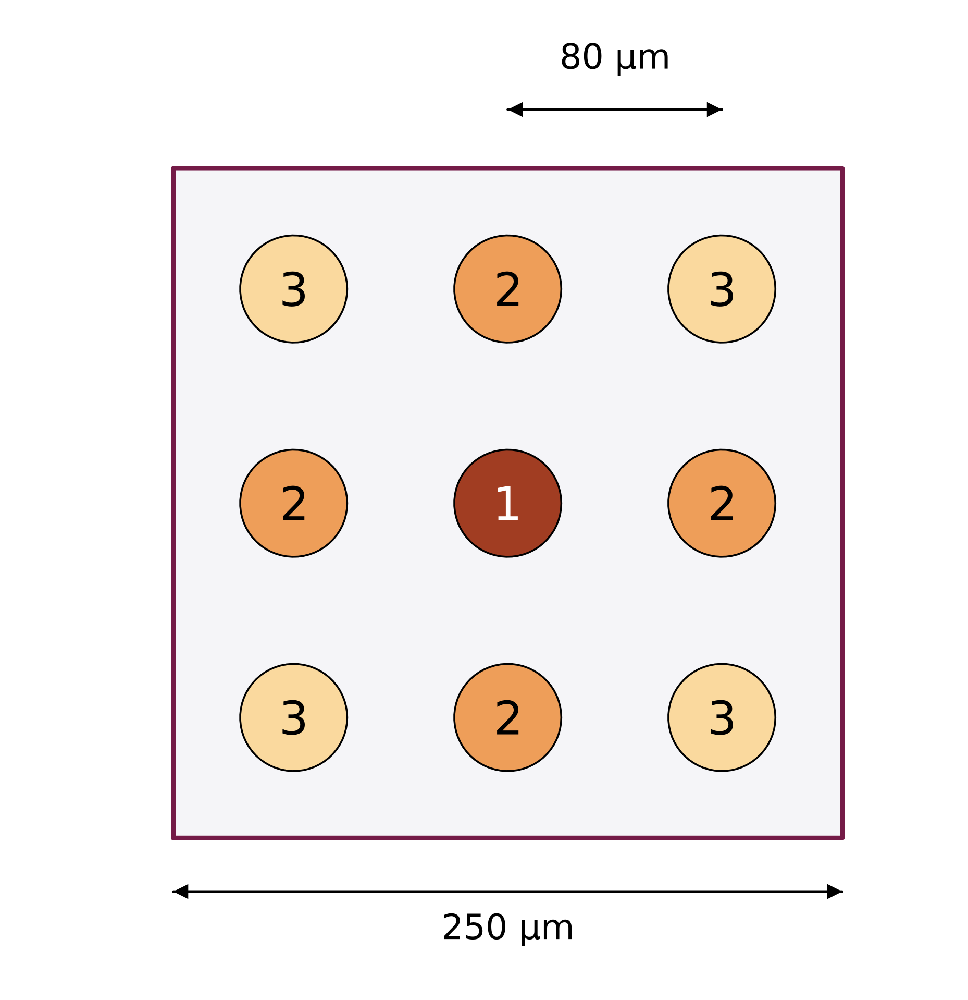
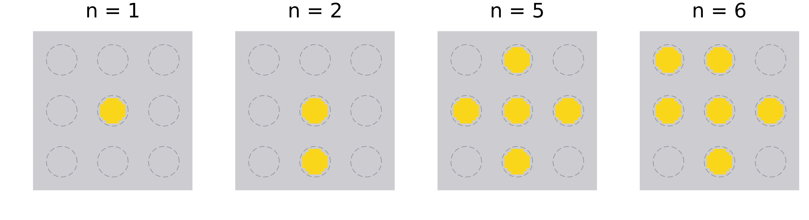
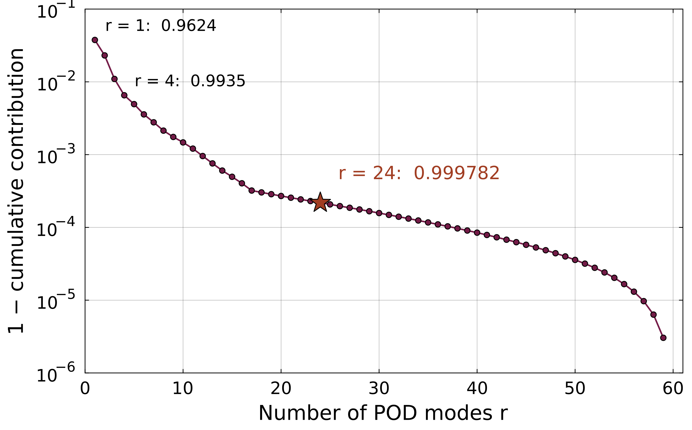
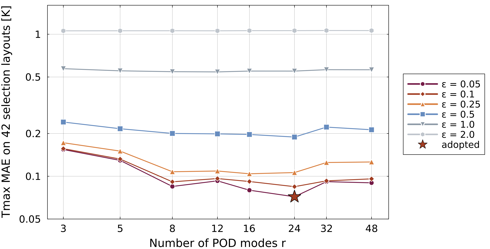
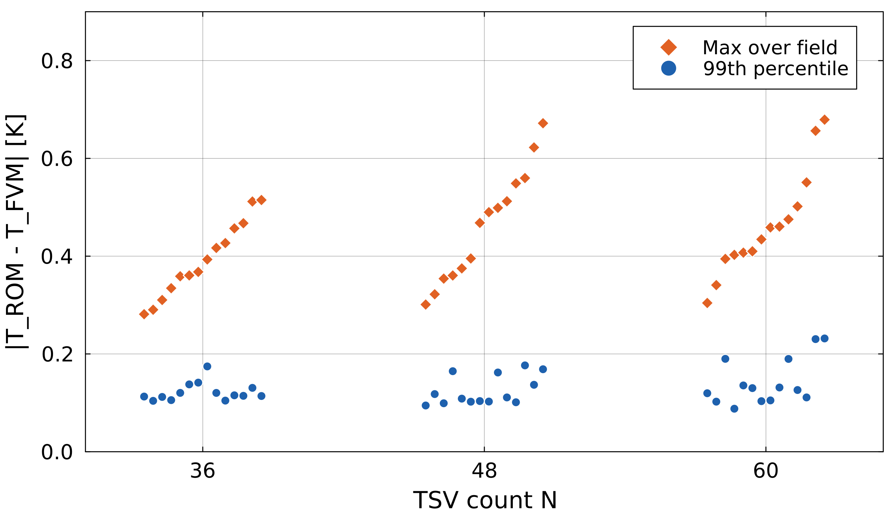

# 密度マップから実座標への変換

  

密度マップ（各セルの本数）

  
→

  

1セル内の候補位置と選ぶ順

- TSV実装領域 1.0 mm角を4×4に分割（1セル250 µm角）
- 最小ピッチ80 µm → 候補位置3×3＝**9点**（1セル最大9本）
- セルの本数 n ＝ round(μ × 9)
- **セル中心に近い順**に n 点を選択 ①中心 → ②上下左右 → ③四隅

FVMの材料分布（上の密度マップの4セルを拡大、黄：TSV、破線：候補位置）

配置は本数から一意に決まる → 設計変数＝16セルの本数

<!--
補助。密度マップから実際のTSV座標への変換です。
実装領域1ミリ角を4×4に分け、1セルは250マイクロメートル角です。最小ピッチ80マイクロメートルから、1セルに置ける候補位置は3×3の9点で、これが1セル最大9本の根拠です。
各セルの本数を、セル中心に近い候補位置から順に置きます。中心、上下左右、四隅の順です。
下は実際のFVMの材料分布で、本数どおりに置かれていることが確認できます。
したがって、配置は16セルの本数から一意に決まり、本研究の設計変数は16セルの本数そのものです。
（中心からの距離が同じ候補の間の順番は、生成コードの数値丸めで決まる固定の順で、設計変数ではありません。）
-->

---

# 密度マップの解像度

予測方法の比較（独立評価42配置）

| 予測方法 | 入力 | 最高温度の平均誤差 |
|---|---|---:|
| 定数（学習平均） | なし | 1.46 K |
| 本数のみ（線形） | N | 0.37 K |
| 16セルの本数（線形） | 密度マップ | 0.146 K |
| **ROM（POD–RBF）** | 密度マップ | **0.095 K** |

本数だけでは不十分、配置（16セル）の情報で誤差が1/4以下

予備検討：入力解像度の比較

| 密度マップ | 温度場L2誤差 |
|---|---:|
| 2×2 | 0.434 % |
| **4×4** | **0.077 %** |
| 8×8 | 0.097 % |
| 16×16 | 0.097 % |

同じTSV配置を各解像度で表しROMを構築 （2026-08の予備検討、60×60×30格子、本研究とは条件が異なる）

本研究の配置は4×4の本数で定義 → 入力の段階で情報の欠落なし

<!--
補助。密度マップは4×4で十分か、という質問への回答です。
まず、本研究では配置そのものが4×4セルの本数で定義されているので、ROMの入力として情報は落ちていません。
左は予測方法の比較です。本数だけを使う線形モデルでは0.37ケルビン、16セルの本数を使う線形モデルで0.146ケルビン、ROMで0.095ケルビンでした。配置の情報が効いていることが分かります。
右は8月の予備検討で、同じ配置を2×2から16×16で表してROMを作った結果です。4×4が最も小さく、細かくしても改善しませんでした。ただし格子や条件が本研究と異なる参考値です。
より細かい配置自由度を扱うことは今後の課題です。
-->

---

# PODとSVD

学習300配置の温度場（1,728,000セル）から平均場を引いて並べる

$$
X = \left[\, \boldsymbol{T}_1 - \bar{\boldsymbol{T}},\ \dots,\ \boldsymbol{T}_{300} - \bar{\boldsymbol{T}} \,\right] \in \mathbb{R}^{1{,}728{,}000 \times 300}
$$

特異値分解（SVD）

$$
X = U \Sigma V^{\mathsf T}, \qquad \boldsymbol{\phi}_j = U \text{ の第 } j \text{ 列},\quad \sigma_1 \ge \sigma_2 \ge \cdots
$$

上位 r 個の基底で温度場を近似

$$
\boldsymbol{T}(\boldsymbol{\mu}) \approx \bar{\boldsymbol{T}} + \sum_{j=1}^{r} a_j(\boldsymbol{\mu})\, \boldsymbol{\phi}_j,
\qquad a_j^{(k)} = \boldsymbol{\phi}_j^{\mathsf T}\!\left(\boldsymbol{T}_k - \bar{\boldsymbol{T}}\right)
$$

- 基底 φ_j は互いに直交、r 個の基底で表す近似の中で2乗誤差が最小
- 累積寄与率 ＝ σ₁² + … + σ_r² を全体で割った値

<!--
補助。PODの中身です。
学習用300配置の温度場から平均場を引いて、172万8000セル×300の行列を作ります。
これを特異値分解すると、左特異ベクトルがPODの基底、特異値がその重要度になります。
上位r個の基底の重ね合わせで温度場を近似し、学習配置の係数は基底への射影で求めます。
基底は互いに直交していて、r個で表す近似の中で2乗誤差が最小になります。
-->

---

# 累積寄与率

  

<b>横軸</b>：POD基底の数 r

<b>縦軸</b>：1 − 累積寄与率（対数）

- 学習300配置の温度場から計算
- ★：採用した r = 24

結果

r = 1：0.9624

r = 24：<strong>0.999782</strong>

保持した60基底（全分散の99.99 %以上）に対する比

r は寄与率ではなく、検証用42配置の誤差で選定（次のスライド）

<!--
補助。累積寄与率です。
縦軸は1から累積寄与率を引いた値を対数で示しています。
1個目の基底だけで0.962、採用した24個で0.999782でした。
この値は、保持した60基底に対する比です。60基底で全分散の99.99パーセント以上を占めます。
なお、基底の数は寄与率のしきい値ではなく、検証用42配置での最高温度の誤差で選んでいます。
-->

---

# RBF補間による係数予測

密度マップ μ（16個）を学習範囲で [0, 1] に正規化 → $\hat{\boldsymbol{\mu}}$

$$
a_j(\boldsymbol{\mu}) = \sum_{k=1}^{300} w_{jk}\, \exp\!\left[ -\left( \varepsilon \,\lVert \hat{\boldsymbol{\mu}} - \hat{\boldsymbol{\mu}}_k \rVert \right)^2 \right]
$$

重みは学習300配置の係数から一括で決定

$$
W = A \left( \Phi + \lambda I \right)^{-1}, \qquad
\Phi_{kl} = \exp\!\left[ -\left( \varepsilon \,\lVert \hat{\boldsymbol{\mu}}_k - \hat{\boldsymbol{\mu}}_l \rVert \right)^2 \right]
$$

$A$：学習配置のPOD係数（r × 300）　$W$：重み（r × 300）

$\varepsilon$：基底の幅（小さいほど滑らか）　$\lambda$：正則化（学習点への過適合を抑える）

- 予測は300個のガウス関数の重ね合わせ → 1回の評価が軽い
- r, ε, λ は検証用42配置で選定（次のスライド）

<!--
補助。係数予測に使ったRBF補間です。
密度マップの16個の値を学習範囲で0から1に正規化し、学習300配置との距離に応じたガウス関数の重ね合わせで係数を予測します。
重みは、学習配置のPOD係数から、正則化したカーネル行列の逆を掛けて一括で求めます。
イプシロンは基底の幅、ラムダは正則化の強さです。
-->

---

# モード数・ε・λの選定

  

<b>横軸</b>：POD基底の数 r

<b>縦軸</b>：最高温度の平均誤差

- 検証用42配置で評価
- 192通り（r 8 × ε 6 × λ 4） 線：ε ごとに λ の最良値
- 選定に使ったのは**検証用42配置のみ**

採用（★）

r = 24, ε = 0.05, λ = 10⁻⁶

検証用42配置：<strong>0.072 K</strong>

独立評価42配置：<strong>0.095 K</strong>

独立評価は選定後に1回だけ実施

<!--
補助。基底の数、イプシロン、ラムダの選び方です。
192通りの組合せを、学習にも評価にも使っていない検証用の42配置で比べ、最高温度の平均誤差が最小の組合せを採用しました。
採用はr=24、イプシロン0.05、ラムダ10のマイナス6乗で、検証誤差は0.072ケルビンです。
精度評価用の42配置は選定に使っておらず、選定後に1回だけ評価して0.095ケルビンでした。
（ε = 0.05 は候補の最小値です。さらに小さいεは試していません。）
-->

---

# 計算時間

| 処理 | 時間 | 条件 |
|---|---:|---|
| FVM 1配置（240 × 240 × 30） | 平均 **400 s**（255〜528 s） | 16配置を並列実行 |
| 学習・評価データ 424配置 | 約 3.0 h | 同上 |
| ROM構築（POD＋192通りの選定） | 3.3 min | — |
| ROM 1回の最高温度評価 | 約 **0.9 ms** | 1スレッド |
| 配置探索（9.4 × 10⁷ 回の評価） | 89 min | 20スレッド |

1回の評価でFVMの約 4 × 10⁵ 倍高速

探索中の最高温度は、学習配置で高温になる上位5万セル（全体の2.9 %）に限定して評価。 全セルで求めた最高温度との差は最大 2 × 10⁻¹³ K（84配置）。

<!--
補助。計算時間です。
FVMは1配置あたり平均400秒で、424配置のデータ作成に約3時間かかりました。
ROMの構築は選定を含めて3.3分です。
ROMで最高温度を1回評価するのは1スレッドで約0.9ミリ秒で、FVMの約40万倍速いです。
探索ではこれを9400万回行い、20スレッドで89分でした。
なお探索中の最高温度は高温になる上位5万セルだけで評価していますが、全セルで求めた値と一致することを確認しています。
-->

---

# 解析条件の妥当性

格子収束（N = 48 の4配置）

| | 240 × 240 × 30 | 480 × 480 × 30 |
|---|---:|---:|
| 最高温度の差 | — | 0.014〜0.016 K |
| 最良と最悪の幅 | 2.7914 K | 2.7931 K |
| 4配置の順位 | — | 一致 |

ずれはほぼ一定 → 配置間の比較には影響しない

学習していない本数での精度

| TSV本数 | 配置数 | 最高温度の平均誤差 |
|---|---:|---:|
| 36, 48, 60（学習本数） | 84 | 0.083 K |
| **42** | 20 | **0.090 K** |
| **54** | 20 | **0.073 K** |

学習した本数の間でも同程度の精度

<!--
補助。解析条件の妥当性です。
左は格子収束です。N=48で最高温度の範囲を等分する4配置を、480×480の格子で再計算しました。最高温度の差は0.014から0.016ケルビンでほぼ一定で、4配置の順位も一致しました。配置間の比較には影響しません。
右は学習していない本数での精度です。N=42と54でも、平均誤差は0.090と0.073ケルビンで、学習した本数と同程度でした。
-->

---

# 温度場全体の最大誤差

  

<b>横軸</b>：TSV本数 N

<b>縦軸</b>：ROMとFVMの温度差

- 独立評価42配置、各配置の全セルで評価
- ◆：最大値　●：99 %点

結果

最大値：0.28〜0.68 K（温度上昇の1.5〜4.5 %）

99 %点：0.09〜0.23 K

最大誤差の位置：42配置中39配置で発熱ブロックの縁付近（z ≈ 0.2 mm）

<!--
補助。温度場全体の最大誤差です。
独立評価の42配置それぞれで、全セルのROMとFVMの差の最大値と99パーセント点を示しています。
最大値は0.28から0.68ケルビンで、温度上昇の1.5から4.5パーセントでした。99パーセント点は0.09から0.23ケルビンです。
最大誤差は発熱ブロックの縁付近に局所的に現れます。
-->
