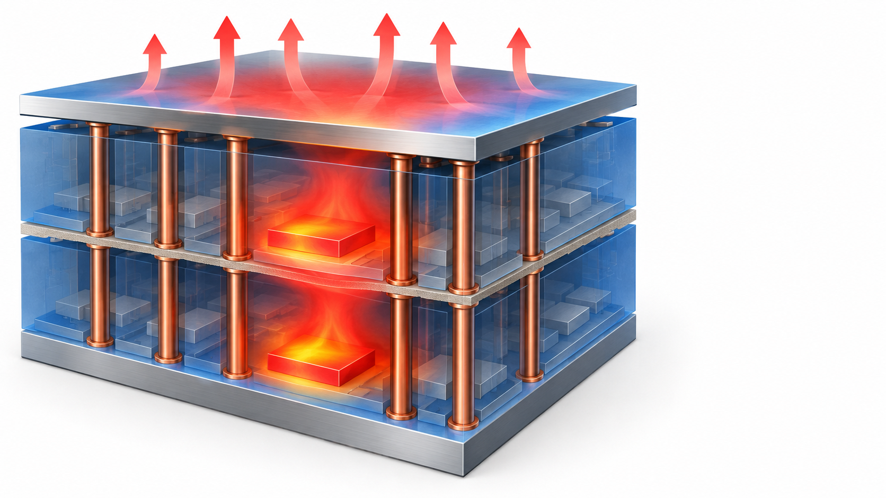
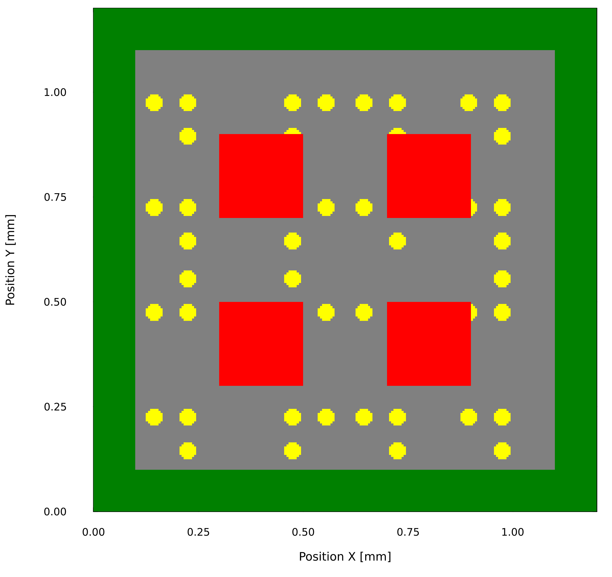
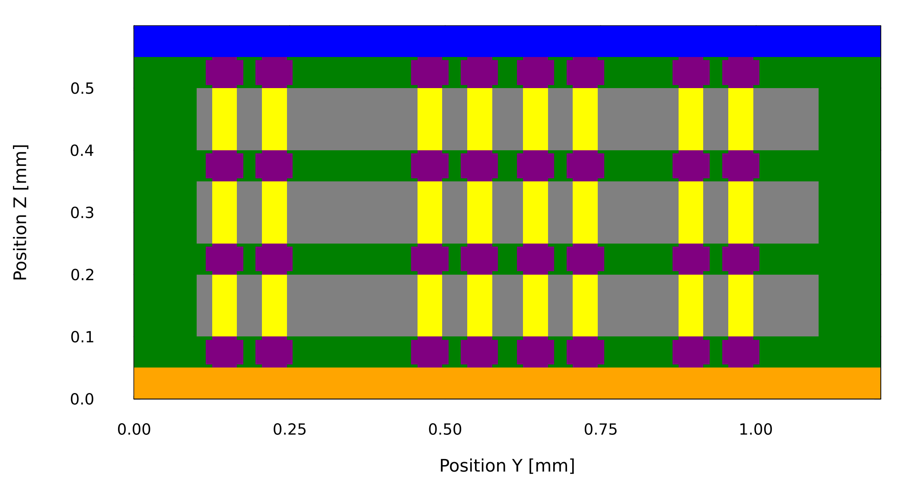
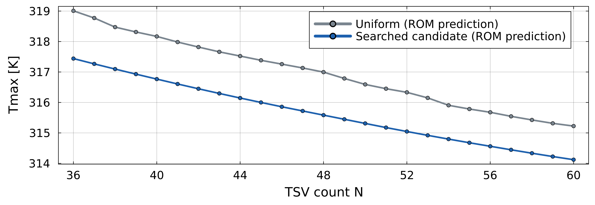
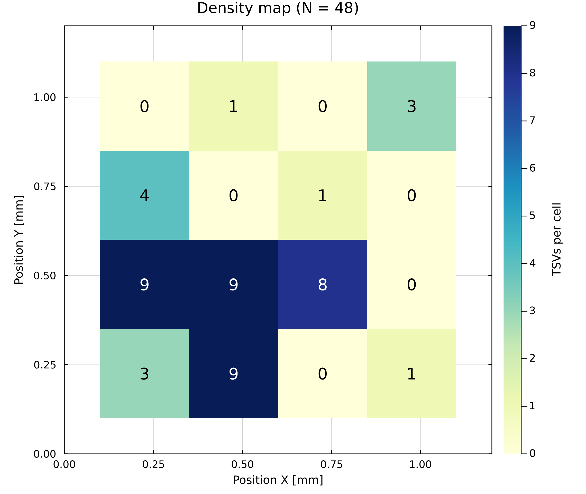
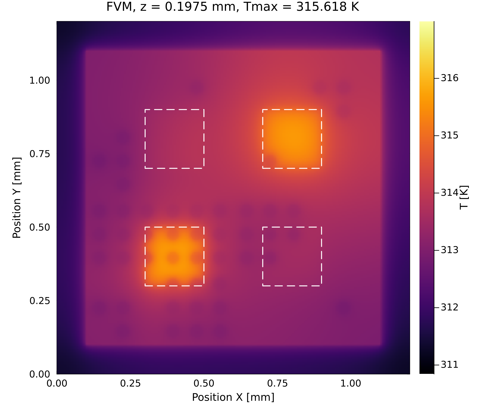
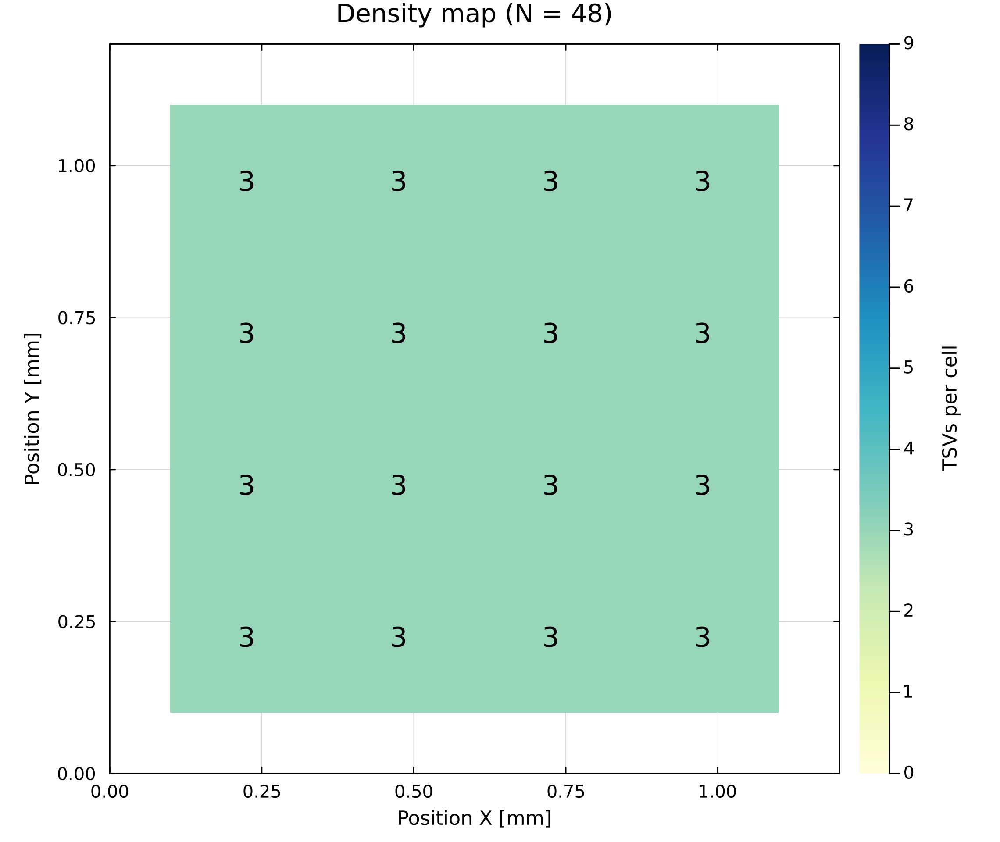
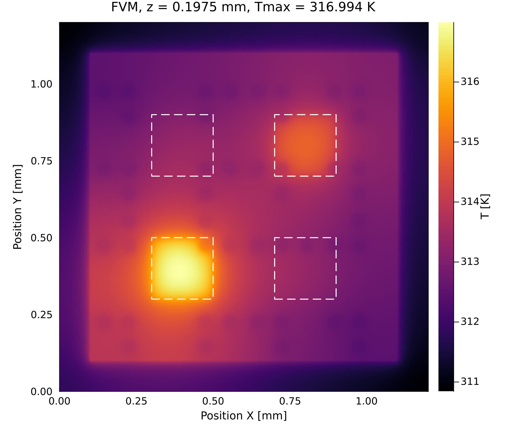

<!-- _class: lead -->

# TSV密度マップを用いた縮約モデルによる 3DIC の熱設計最適化の研究

### 大屋 蒼真・小野 謙二（九州大学）

熱工学コンファレンス2026　B11

<!--
目安 0:20。
3D-ICの熱設計において、多数のTSV配置を高速に比較するための仕組みを検討しました。
本日は、その考え方と、ROMによる予測およびFVMでの確認結果を報告します。
-->

---

# 3D-ICの熱問題とTSV配置

ICの立体集積による<strong>熱問題</strong>が課題

↓

チップ内の熱輸送に影響する<strong>TSV</strong>の <strong>配置の最適化</strong>が必要

TSV（through-silicon via）：層を貫通する配線

↓

> **TSV配置を高速に評価し、低温な配置を探す**

<small>右上：3D-ICイメージ図 右下：NIST, “3D stacked integrated circuit”, nist.gov/image/3dicjpg</small>

<!--
目安 0:45。
ICを立体的に積層すると高密度化・高性能化を図れますが、高温部が生じて動作不良の原因となる、熱の問題が課題です。
層を貫通するTSVは信号経路であると同時に、チップ内の熱輸送にも影響します。
そのため、TSVの配置を最適化して最高温度を下げることが必要です。
ただし配置の組合せは膨大なので、本研究ではTSV配置を高速に評価し、低温な配置を探します。
-->

---

# 本研究の流れ

膨大なTSV配置から低温な配置を見つけるための4段階

  
<strong>① 入力を減らす</strong> TSV配置を 16個の数で表す

→

  
<strong>② 近似モデル</strong> 限られた数の FVM計算から 温度場を高速に予測 （別データで精度を確認）

→

  
<strong>③ 探索</strong> モデルで多数の 配置を評価し 低温な候補を選ぶ

→

  
<strong>④ 確認</strong> 選んだ候補を FVMで再計算

<!--
目安 0:45。
膨大な配置の中から低温な配置を見つけるため、本研究は4つの段階で進めました。
まず、TSV配置を16個の数で表し、入力を減らします。
次に、限られた数のFVM計算から、温度場を高速に予測する近似モデル、縮約モデルを作り、別のデータで精度を確認します。
そのモデルで多数の配置を評価して低温な候補を選び、最後に選んだ候補をFVMで再計算して確認しました。
まず、解析に用いたモデルを示します。
-->

---

# 解析モデル

  
  
  
上：XY断面　下：YZ断面（一様配置 N=48）

- 1.2 mm角・厚さ0.6 mmの**3層積層モデル**
- 各Si層に**発熱ブロック4個** 総発熱量**0.384 W**
- 上面：周囲**300 K**への対流 側面・下面：断熱
- 中央1 mm角がTSV実装領域 （TSV配置は3層共通）
- FVM：240×240×30セル

黄：Cu TSV　灰：Si　赤：発熱ブロック 紫：バンプ　緑：樹脂　青：Alスプレッダ　橙：PCB

<!--
目安 0:40。
解析対象は1.2ミリ角、厚さ0.6ミリの3層積層モデルです。
各シリコン層に赤で示す発熱ブロックを4個置き、総発熱量は0.384ワットです。
上面は周囲温度300ケルビンへの対流、側面と下面は断熱としました。
中央1ミリ角がTSVの実装領域で、TSV配置は3層で共通です。
このTSV配置を、次のように少ない数で表します。
-->

---

# TSV密度マップ

TSV座標をそのまま入力とすると、本数 *N* に応じて入力数が増加 → TSV実装領域を4×4に分割し、**各セルのTSV本数**を入力とする

  
  
→ 展開

  

入力：TSV座標 2<em>N</em> 個（<em>N</em> = 36〜60 で 72〜120 個）→ 密度マップ <strong>16 個</strong>に圧縮（<em>N</em> によらず一定）

<!--
目安 0:45。
個々のTSV座標をそのまま設計変数にすると、TSV本数とともに入力が増え、学習と探索が難しくなります。
そこでTSV実装領域を4掛ける4に分け、各セルのTSV本数を固定長16成分の密度マップとして表しました。
本数が36から60本なら、座標は72から120個ですが、これを本数によらず16個に圧縮します。
左が48本のランダム配置の密度マップ、右がそこから展開した実際のTSV配置です。セルの数字と、その中のTSVの本数が対応しています。
この16個を入力として温度場を予測するモデルを、次に説明します。
-->

---

# 縮約モデル（POD–RBF ROM）

FVM温度場 **300配置**（*N* = 36, 48, 60 各100）から**主要な空間パターン**をPODで抽出

$$
T(\mathbf{x};\boldsymbol{\mu}) \approx \overline{T}(\mathbf{x}) + \sum_{j=1}^{r} a_j(\boldsymbol{\mu})\,\phi_j(\mathbf{x})
$$

$\mathbf{x}$：位置　$\boldsymbol{\mu}$：TSV配置（密度マップ）
$T$：温度場　$\overline{T}$：平均温度場
$\phi_j$：$j$番目の空間パターン
$a_j$：パターン$j$の係数　$r$：パターン数（24）

  
<strong>入力</strong> 密度マップ16個

→

  
RBF補間で 係数 <em>aj</em> 24個を予測

→

  
空間パターンの 重ね合わせ

→

  
<strong>出力</strong> 三次元温度場

温度値 1,728,000 個 → 係数 24 個で表現 パターン数とRBFの条件は、構築用とは別の42配置で決定

<!--
目安 1:20。
TSV本数36、48、60の各100配置、合計300配置のFVM温度場から、温度分布の変化を表す主要な空間パターンをPODで抽出します。
温度場は、平均温度場に各パターンを係数付きで重ね合わせて近似します。パターン数は24です。
予測では、前のスライドの16個の密度マップを入力とし、RBF補間で24個の係数を求め、パターンを重ね合わせて三次元温度場を出力します。
これにより、約173万個の温度値を24個の係数で表します。これをPOD–RBF ROMと呼びます。
パターン数とRBFの条件は、構築用とは別の42配置で選定しました。
次に、構築に使っていない配置で精度を確認します。
-->

---

# ROMの精度検証結果

  

**横軸**：FVMの最高温度 **縦軸**：ROMの最高温度

- ROMの構築に使っていない**42配置**で評価
- 破線（y = x）からの距離＝FVMとROMの最高温度の誤差

結果

最高温度の平均誤差：<strong>0.0950 K</strong>

温度場の2乗平均誤差：<strong>0.493 %</strong>

（300 Kからの温度上昇に対する比）

<!--
目安 1:00。
ROMの構築に使っていない42配置で、FVMとROMの最高温度を比較しました。
横軸がFVM、縦軸がROMの最高温度で、破線からの距離が両者の誤差を表します。
最高温度の誤差は平均0.0950ケルビンでした。
温度場全体でも、2乗平均の誤差は300ケルビンからの温度上昇の0.493パーセントでした。
このROMを配置探索へ使用します。
-->
---

# 最高温度を目的とした配置探索

各TSV本数を固定し、ROMが予測する最高温度を目的に **マルチスタート離散局所探索**を実施

  
初期配置

→

  
TSVを1本 別セルへ移動

→

  
最大240近傍を ROMで評価

→

  
最も低温な 配置へ更新

↺

  
<strong>25</strong> 本数水準 N=36〜60

  
<strong>400</strong> 初期配置／各N

  
<strong>1</strong> 近傍で移動する TSV本数

<small>改善する近傍がなくなるまで反復。各 <em>N</em> の400初期配置から得た候補のうち、ROMが予測する最高温度が最も低い配置を採用</small>

<!--
目安 0:55。
目的関数はROMが予測する最高温度です。
TSV本数は一回の探索中では固定し、36本から60本までの25水準を別々に探索しました。
一つのTSVを別のセルへ移す最大240近傍を評価し、最も温度が下がる配置へ更新します。
これを改善がなくなるまで繰り返し、各本数について400個の初期配置から得た中で最も低温な候補を選びました。
-->

---

# TSV本数と最高温度の近似トレードオフ

  

<strong>横軸</strong>：TSV本数 <em>N</em>

<strong>灰</strong>：一様配置

<strong>縦軸</strong>：ROMが予測した最高温度

<strong>青</strong>：探索で得た低温候補

- *N* = 36〜60の**25水準**（ROM予測値）
- 同じ本数で、配置による最高温度の違いを見る

結果

全25水準で探索候補が一様配置より低温

差：<strong>1.09〜1.57 K</strong>

本数ごとの局所探索の結果（大域最適解ではない）

<!--
目安 0:55。
横軸がTSV本数、縦軸がROMが予測した最高温度です。
灰色が一様配置、青が各本数で探索して得た低温候補で、36本から60本までの25水準を示しています。
同じ本数で配置を変えると、最高温度がどれだけ下がるかを見る図です。
全25水準で探索候補が一様配置より低温で、その差は1.09から1.57ケルビンでした。
これは本数ごとの局所探索の結果で、大域最適解ではありません。
次に、選んだ候補をFVMで確認した結果を示します。
-->
---

# 探索候補のFVM再検証

  
探索で得た低温候補

  
  

  
一様配置

  
  

<strong>上</strong>：密度マップ（<em>N</em> = 48）

<strong>下</strong>：FVM温度場（最下層Si層の発熱層）

FVM最高温度

探索候補：<strong>315.618 K</strong>

一様配置：316.994 K

差：<strong>1.376 K</strong>（温度上昇の<strong>8.1 %</strong>）

ROMの予測との差

探索候補：0.035 K　一様配置：0.002 K

温度上昇：一様配置の最高温度 − 300 K 固定した発熱分布・解析条件での低温候補

<!--
目安 1:10。
48本の場合について、左が探索で得た低温候補、中央が一様配置です。
上が密度マップ、下がFVMで計算した、最も温度の高い最下層の発熱層の温度分布です。
一様配置では左下の発熱ブロックが最も高温です。探索候補では、TSVがこのブロックの周りに集まっています。
両者をFVMで再計算すると、低温候補は315.618ケルビン、一様配置は316.994ケルビンでした。
差は1.376ケルビンで、一様配置の温度上昇、つまり最高温度と周囲温度300ケルビンの差の8.1パーセントにあたります。
36本と60本では、それぞれ1.355ケルビン、1.119ケルビンで、7.1パーセントと7.3パーセントでした。
ROMの予測とFVMの差は、48本では探索候補で0.035ケルビン、一様配置で0.002ケルビンでした。
（質疑用メモ：36本ではROMが予測した差1.567ケルビンに対しFVMは1.355ケルビンで、ROMが約0.21ケルビン大きく見積もっていた。60本はROM 1.104ケルビン、FVM 1.119ケルビン。）
したがってROM上だけでなく、FVMでも候補選別の効果を確認できました。
ただし、得られたのは低温候補であり、大域最適性を保証するものではありません。
-->

---

<!-- _class: lead -->

# まとめ

> **POD–RBF ROMを、FVMで再計算すべき低温配置候補の選別に利用できた**

  
<strong>300配置</strong> FVM温度場から ROMを構築

  
<strong>0.0950 K</strong> 最高温度の 平均誤差

  
<strong>25水準</strong> N=36〜60を 本数別に探索

  
<strong>1.119–1.376 K</strong> FVM確認済み低減量 （温度上昇の7.1〜8.1 %）

**密度マップ → ROM構築・精度確認 → 本数別探索 → FVM再確認**

<small>結論の範囲：固定した非一様発熱分布、境界条件、TSV径、3層共通配置。ROMはFVMの完全な代替ではない</small>

<!--
目安 0:40。累積約10:05。
まとめです。
300配置のFVM温度場からPOD–RBF ROMを構築しました。
独立評価42配置の最高温度を平均0.0950ケルビンの誤差で予測しました。
このROMを使って36本から60本までの25水準を本数別に探索しました。
選んだ候補はFVMでも一様配置より1.119から1.376ケルビン、温度上昇の7.1から8.1パーセント低温でした。
以上から、固定条件の範囲で、ROMをFVMで再計算すべき低温候補の選別に利用できました。
-->
