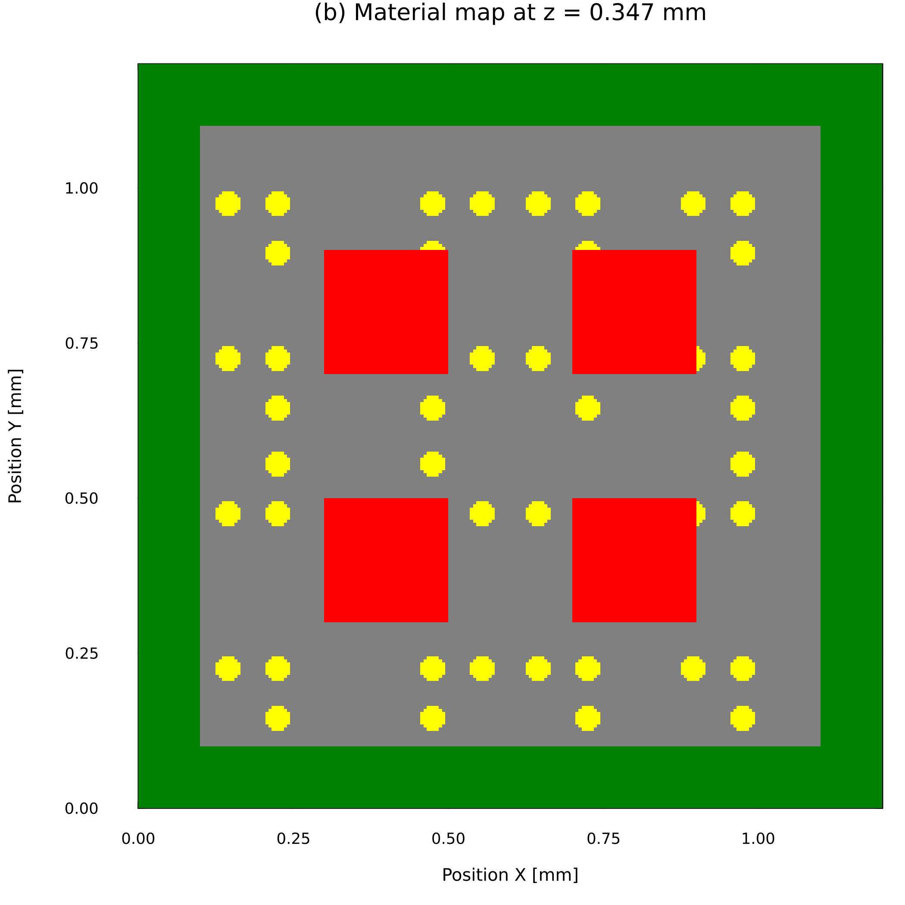

<!-- _class: lead -->
<!-- _footer: "" -->

# TSV密度マップを用いた縮約モデルによる 3DIC の熱設計最適化の研究

### 大屋 蒼真・小野 謙二（九州大学）

熱工学コンファレンス2026　B11

<!--
目安 0:20。
3D-ICの熱設計において、多数のTSV配置を高速に比較するための仕組みを検討しました。
本日は、その考え方と、ROMによる予測およびFVMでの確認結果を報告します。
-->

---

# 3D-ICの熱問題

ICの積層により、さらなる**高密度化・高性能化**を図ります。

↓

高密度化によって高温部が生じ、**動作不良の原因**となります。

> **設計によって最高温度を抑える工夫が必要です。**

<small>右：3D-ICの熱問題を示す生成概念図。今回の解析モデルや解析結果そのものではありません。</small>

<!--
目安 0:50。
ICを積層することにより、平面方向だけでなく垂直方向にも素子を配置でき、さらなる高密度化と高性能化を図れます。
一方、高密度化によって高温部が生じると、動作不良の原因となります。
そのため、設計によって最高温度を抑える工夫が必要です。
-->

---

# 設計初期における配置評価

層を貫通するTSV（through-silicon via）は、信号経路に加えて**チップ内の熱輸送**にも影響します。

TSV配置を設計パラメータとすると、膨大なパターンの配置をシミュレーションしなければなりません。

↓

> **様々なTSV配置を高速にシミュレーションする方法を考えます。**

<small>右上：3D-ICとTSVの概念図（原出典・利用条件は確認中）／右下：本研究モデルのXY材料分布</small>

<!--
目安 0:55。
層を貫通するTSVは信号経路として使われますが、同時にチップ内の熱輸送にも影響します。
このTSV配置を設計パラメータとして扱うと、評価すべき配置パターンは膨大になります。
そこで本研究では、様々なTSV配置を高速にシミュレーションする方法を考えます。
まず、高速評価に用いる縮約モデルを説明します。
-->

---

# 縮約モデル（ROM）

ROMでは、複数のFVM温度場から主要な空間パターンを抽出し、未知配置の温度場を少数の係数から再構成します。

$T(\mathbf{x};\boldsymbol{\mu}) \approx \bar{T}(\mathbf{x}) + \sum_{j=1}^{r} a_j(\boldsymbol{\mu})\,\phi_j(\mathbf{x})$

  
FVM 温度場群

→

  
POD 主要モード

→

  
RBF 係数予測

→

  
未知配置の 温度場

  
<strong>1,728,000</strong> FVM温度自由度

  
→

  
<strong>24</strong> 採用PODモード

<small>24モードの累積寄与率は0.999782。RBFは密度パラメータからPOD係数を予測します。</small>

<!--
目安 1:15。
ROMでは、複数のFVM温度場からPODによって主要な空間パターンを抽出します。
未知の設計入力に対しては、RBFで各モードの係数を予測し、その重ね合わせから温度場を再構成します。
本研究のFVM温度場は約173万自由度ですが、採用したPODモードは24個です。
ただし、温度場を低次元化しても、ROMへ与える設計入力が高次元のままでは別の問題が残ります。
-->

---

# TSV密度マップ

個々のTSV座標を入力すると、TSV本数に応じて入力が増加します。そこで、TSV実装領域を4×4に分割し、各セルのTSV本数をROMへの入力としました。

入力は固定長16成分の密度ベクトル $\boldsymbol{\mu}=(\mu_1,\ldots,\mu_{16})$ となり、密度マップから決定規則に従って実TSV配置へ展開します。

<small>各セル0〜9本。密度解像度間の比較および「次元の呪いを回避した」という実証は本発表の対象外です。</small>

<!--
目安 1:00。
個々のTSV座標をそのまま設計変数にすると、TSV本数とともに入力が増え、学習と探索が難しくなります。
そこでTSV実装領域を4掛ける4に分け、各セルのTSV本数を16成分の入力としました。
左がROM入力となる密度マップ、中央と右が密度から展開された実際の三層構造です。
この表現によって、TSV本数が変わってもROM入力を固定長にできます。
-->

---

# 解析・評価方法

FVMで得た424配置を役割ごとに分け、ROMの構築・モデル選定と独立した配置で予測性能を評価しました。

  
<strong>300</strong> ROM構築

  
<strong>42</strong> モデル選定

  
<strong>42</strong> 独立評価

  
<strong>40</strong> 本数補間

  
FVM 424配置

→

  
POD–RBF ROM構築

→

  
配置探索

→

  
代表8配置を FVM再計算

<small>3層モデル／総発熱量0.384 W／上面対流・側面下面断熱／FVM 240×240×30セル／3層共通TSV配置</small>

<!--
目安 1:00。
FVMで得た424配置を役割ごとに分けました。
300配置でROMを構築し、42配置でモード数などを選定しました。
さらに、これらに使用していない42配置を独立評価に使い、残る40配置で学習していないTSV本数への補間を確認しました。
精度確認後、ROMで配置を探索し、選んだ候補をFVMで再計算します。
-->

---

# ROMの予測精度

> **独立評価42配置における最高温度MAEは0.0950 Kでした。**

  
<strong>0.0950 K</strong> 最高温度MAE

  
<strong>0.493%</strong> 温度場相対L2誤差

<small>図はtest中でTmax誤差が最大のn60_123。相対L2誤差は300 Kからの温度上昇を基準に算出しました。</small>

<!--
目安 1:20。
左がFVM、中央がROM、右がROMからFVMを引いた誤差です。
表示したのは見栄えのよい平均例ではなく、独立評価中で最高温度誤差が最大だったケースです。
ホットスポットの位置と温度場の構造は概ね再現されています。
独立評価42配置では最高温度MAEが0.0950ケルビン、温度上昇基準の温度場相対L2誤差が0.493パーセントでした。
このROMを使って、多数の配置候補を評価します。
-->

---

# ROMを用いた配置探索

構築したROMを目的関数として反復評価し、TSV本数ごとに最高温度が低くなる配置候補を探索しました。

  
4×4 密度マップ

→

  
ROMで 最高温度評価

→

  
配置を更新

↺

  
低温候補を 選別

  
<strong>約9.40×10⁷</strong> ROM評価回数

  
<strong>89.1分</strong> 探索時間

<small>TSV本数36〜60の25水準／各水準400リスタート／20スレッド。FVMとの速度倍率ではなく、最終探索ログに記録された規模と所要時間です。</small>

<!--
目安 1:10。
構築したROMを目的関数として繰り返し評価し、TSV本数ごとに最高温度が低くなる配置を探索しました。
36本から60本までの25水準を対象とし、合計約9400万回のROM評価を89.1分で行いました。
ここで示す時間は探索全体の実測値であり、FVMとの直接的な速度向上率ではありません。
次に、選ばれた候補をFVMで再計算した結果を示します。
-->

---

# 探索配置のFVM検証

> **ROMで選んだ配置は、FVMでも同一本数の一様配置より低温となりました。**

  

    

      
探索配置（N=48）

      

        
3

9

0

1

        
9

9

8

0

        
4

0

1

0

        
0

1

0

3

      

    

    

      
一様配置（N=48）

      

        
3

3

3

3

        
3

3

3

3

        
3

3

3

3

        
3

3

3

3

      

    

  

  

    探索配置：<strong>315.618 K</strong> 
    一様配置：316.994 K 
    低減量：<strong>1.376 K</strong>
  

N=36、48、60でFVM確認済みの最高温度低減量は、**1.119〜1.376 K**でした。

<small>数字は密度セルごとのTSV本数。探索配置は低温候補であり、設計空間全体の大域最適解とは限りません。</small>

<!--
目安 1:20。
左は48本の場合のセル別TSV本数です。一様配置では各セルに3本ずつですが、探索配置では発熱分布に対応してTSVが偏って配置されています。
両者をFVMで再計算すると、探索配置は315.618ケルビン、一様配置は316.994ケルビンで、1.376ケルビン低温でした。
36本、48本、60本の三条件でも、FVMで1.119から1.376ケルビンの低減を確認しました。
ただし、得られたのは低温候補であり、大域最適性を保証するものではありません。
-->

---

<!-- _class: lead -->

# まとめ

> **POD–RBF ROMを、FVMで再計算すべき低温配置候補の選別に利用できました。**

  
<strong>16成分</strong> 4×4 TSV 密度マップ

  
<strong>0.0950 K</strong> 未知配置の Tmax MAE

  
<strong>1.119–1.376 K</strong> FVM確認済み 低減量

**密度マップ → ROMによる多数評価 → 候補選別 → FVM再確認**

<small>結論の範囲は、固定した非一様発熱分布、境界条件、TSV径、3層共通配置です。ROMはFVMの完全な代替ではありません。</small>

<!--
目安 0:40。累積9:50。
まとめです。
TSV配置を4掛ける4の密度マップで表し、POD–RBF ROMを構築しました。
未知配置の最高温度を平均0.0950ケルビンの誤差で予測し、ROMで選んだ候補はFVMでも一様配置より1.119から1.376ケルビン低温でした。
以上から、固定条件の範囲で、ROMをFVMで再計算すべき低温候補の選別に利用できました。
-->
