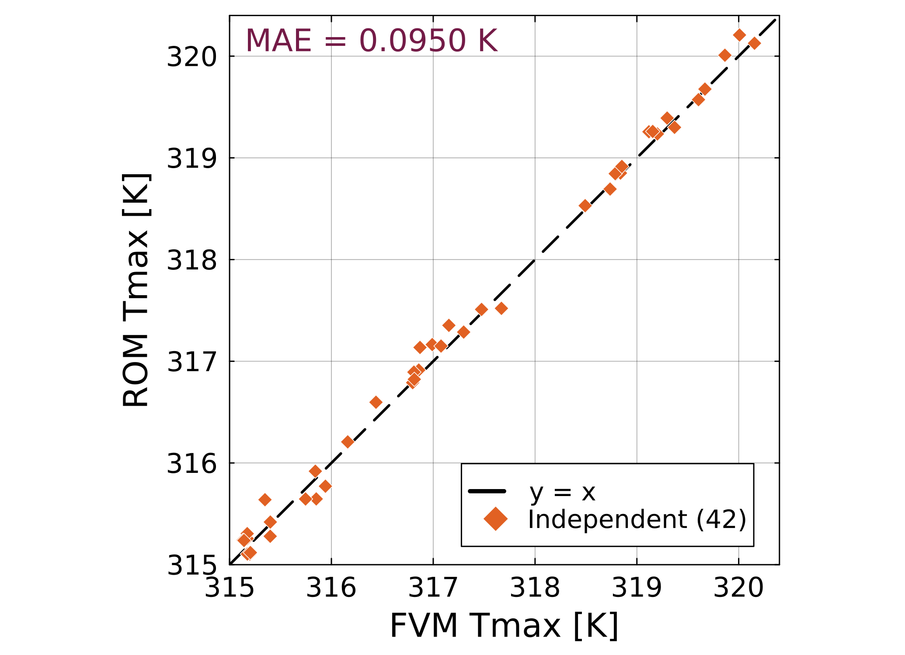
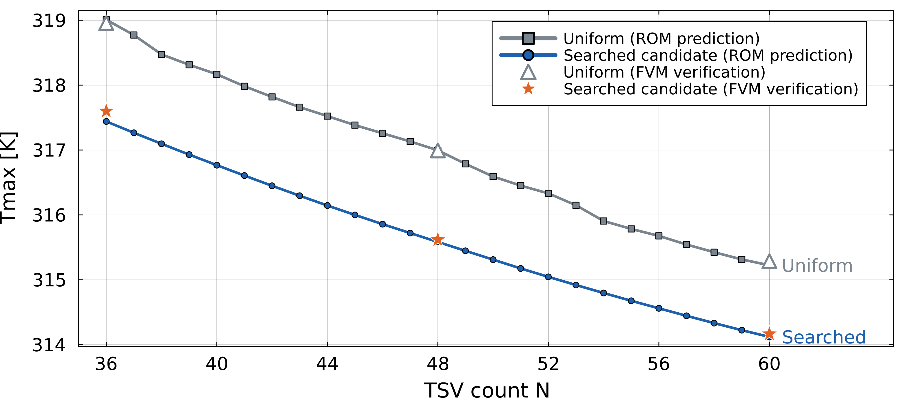
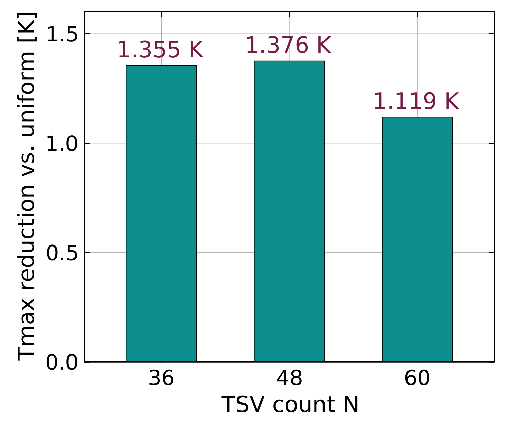

<!-- _class: lead -->
<!-- _footer: "" -->

# TSV密度マップを用いた縮約モデルによる 3D-ICの熱設計最適化の研究

### 大屋 蒼真・小野 謙二（九州大学）

熱工学コンファレンス2026　B11

<!--
目安 0:20。
3D-ICの熱設計において、多数のTSV配置を高速に比較するための仕組みを検討しました。
本日は、その考え方と、ROMによる予測およびFVMでの確認結果を報告します。
-->

---

# 3D-ICの熱問題

ICの積層により、さらなる**高密度化・高性能化**を図ります。

↓

高密度化によって高温部が生じ、**動作不良の原因**となります。

> **設計によって最高温度を抑える工夫が必要です。**

<small>右：3D-ICの熱問題を示す生成概念図。今回の解析モデルや解析結果そのものではありません。</small>

<!--
目安 0:50。
ICを積層することにより、平面方向だけでなく垂直方向にも素子を配置でき、さらなる高密度化と高性能化を図れます。
一方、高密度化によって高温部が生じると、動作不良の原因となります。
そのため、設計によって最高温度を抑える工夫が必要です。
-->

---

# 設計初期における配置評価

層を貫通するTSV（through-silicon via）は、信号経路に加えて**チップ内の熱輸送**にも影響します。

TSV配置を設計パラメータとすると、膨大なパターンの配置をシミュレーションしなければなりません。

> **本研究：TSV密度マップを入力とする縮約モデル（ROM）で低温配置の候補を選び、FVMで確認しました。**

結果：FVMでも、同じTSV本数の一様配置より最高温度が<strong>1.12〜1.38 K</strong>低い候補を得ました。

<small>右上：3D-ICとTSVの概念図（出典：NIST, “3D stacked integrated circuit”, nist.gov/image/3dicjpg）／右下：本研究モデルのXY材料分布</small>

<!--
目安 1:00。
層を貫通するTSVは信号経路として使われますが、同時にチップ内の熱輸送にも影響します。
このTSV配置を設計パラメータとして扱うと、評価すべき配置パターンは膨大になります。
そこで本研究では、TSV密度マップを入力とする縮約モデル、ROMで温度を高速に予測し、低温になる配置の候補を選んで、FVMで確認しました。
結果として、FVMでも同じ本数の一様配置より1.12から1.38ケルビン低温な候補が得られました。
以下、ROM、密度マップ、ROMの構築と精度、配置探索、FVMでの確認の順に説明します。
-->

---

# 縮約モデル（ROM）

複数のFVM温度場から、温度分布の変化を表す**主要な空間パターン**をPOD（固有直交分解）で抽出します。

  
複数の FVM温度場

→

  
PODによる パターン抽出

→

  
主要な 空間パターン

未知配置の温度場は、各パターンに係数を掛けて**重ね合わせる**ことで近似します。

$$
T(\mathbf{x};\boldsymbol{\mu}) \approx \overline{T}(\mathbf{x}) + \sum_{j=1}^{r} a_j(\boldsymbol{\mu})\,\phi_j(\mathbf{x})
$$

$\mathbf{x}$：位置　$\boldsymbol{\mu}$：TSV配置（密度マップ）
$T$：温度場　$\overline{T}$：平均温度場
$\phi_j$：$j$番目の空間パターン
$a_j$：パターン$j$の係数　$r$：パターン数

  
<strong>1,728,000</strong> 個の温度値

  
→

  
<strong>24</strong> 個の係数

<!--
目安 1:05。
複数のFVM温度場から、温度分布の変化を表す主要な空間パターンをPODで抽出します。
未知配置の温度場は、平均温度場に各パターンを係数付きで重ね合わせることで近似します。
本研究ではパターン数を24とし、約173万個の温度値を24個の係数で表します。
次に、TSV配置をROMへ入力する方法を説明します。
-->

---

# TSV密度マップ

個々のTSV座標を入力すると、TSV本数に応じて入力が増加します。そこで、TSV実装領域を4×4に分割し、各セルのTSV本数をROMへの入力としました。

  
  
  

  
TSV座標 <em>N</em>本 × (<em>x</em>, <em>y</em>) ＝ 2<em>N</em>個

→

  
4×4セルごとに 本数を集計

→

  
密度マップ 16個（<em>N</em>によらず一定）

<!--
目安 0:55。
個々のTSV座標をそのまま設計変数にすると、TSV本数とともに入力が増え、学習と探索が難しくなります。
そこでTSV実装領域を4掛ける4に分け、各セルのTSV本数を固定長16成分の密度マップとして表しました。
左が48本のランダム配置の密度マップ、中央と右がそこから展開した実際のTSV配置です。
この16個がROMの入力になります。
-->

---

# ROMの構築方法

> **密度マップ16成分から三次元温度場を予測するPOD–RBF ROMを、300配置のFVM温度場で構築しました。**

  
<strong>100</strong> N=36

  
<strong>100</strong> N=48

  
<strong>100</strong> N=60

  
→

  
POD基底 24モード

  
<strong>入力</strong> 密度マップ16成分

→

  
RBF補間で 係数24個を推定

→

  
POD基底の 重ね合わせ

→

  
<strong>出力</strong> 三次元温度場

RBF補間：学習配置との密度マップの近さに応じて係数を補間します。 24モードとRBF条件は、構築用とは別の<strong>モデル選定42配置</strong>で決定しました。

解析条件：3層モデル／総発熱量0.384 W／上面対流・側面下面断熱／FVM 240×240×30セル／3層共通TSV配置

<!--
目安 1:00。
前のスライドの16成分の密度マップから、三次元温度場を予測するROMを作ります。
まず、TSV本数36、48、60の各100配置、合計300配置のFVM温度場から、POD基底を24モード求めました。
予測では、密度マップを入力として、学習配置との密度マップの近さに応じたRBF補間で24個の係数を推定し、POD基底を重ね合わせて三次元温度場を出力します。
これをPOD–RBF ROMと呼びます。
モード数とRBFの条件は、構築用とは別の42配置で選定しました。
ここまでは構築方法であり、次に独立したデータで精度を確認します。
-->

---

# ROMの精度検証結果

  

    
  

  

    
ROM構築・モデル選定に使用していない <strong>独立評価42配置</strong>

    
<strong>0.0950 K</strong> 最高温度MAE

    
<strong>0.493%</strong> 温度場相対L2誤差 300 Kからの温度上昇基準

  

<!--
目安 0:55。
ROM構築とモデル選定に使用していない独立評価42配置で、FVMとROMの最高温度を比較しました。
点が破線に近いほど両者が一致しています。
最高温度の平均絶対誤差は0.0950ケルビン、温度上昇基準の温度場相対L2誤差は0.493パーセントでした。
このROMを配置探索へ使用します。
-->

---

# 最高温度を目的とした配置探索

各TSV本数を固定し、ROMが予測する最高温度を目的とする **マルチスタート離散局所探索**を行いました。

  
初期配置

→

  
TSVを1本 別セルへ移動

→

  
最大240近傍を ROMで評価

→

  
最も低温な 配置へ更新

↺

  
<strong>25</strong> 本数水準 N=36〜60

  
<strong>400</strong> 初期配置／各N

  
<strong>1</strong> 近傍で移動する TSV本数

改善する近傍がなくなるまで反復し、各Nの400初期配置から得た候補のうち、ROMが予測する最高温度が最も低い配置を選びました。

<!--
目安 0:55。
目的関数はROMが予測する最高温度です。
TSV本数は一回の探索中では固定し、36本から60本までの25水準を別々に探索しました。
一つのTSVを別のセルへ移す最大240近傍を評価し、最も温度が下がる配置へ更新します。
これを改善がなくなるまで繰り返し、各本数について400個の初期配置から得た中で最も低温な候補を選びました。
-->

---

# TSV本数と最高温度の近似トレードオフ

各TSV本数で得た低温候補と、同じ本数の一様配置を比較しました。

  

四角・丸の線：ROM予測値（N=36〜60）　　三角・星：FVM確認値（N=36、48、60）

> **同じTSV本数でも、配置探索によって一様配置より低温な候補が得られました。**

本数別の局所探索で得た候補を並べたもので、大域最適解や真のパレートフロントではありません。

<!--
目安 0:55。
横軸がTSV本数、縦軸が最高温度です。
灰色の四角が一様配置、青の丸が各本数で探索された低温候補で、どちらもROM予測値です。
本数を増やすほど最高温度が低下するとともに、同じ本数でも探索候補は一様配置より低温になっています。
三角と星で示した36、48、60本についてはFVMで再計算しました。
この曲線は各本数の局所探索結果を並べたもので、真のパレートフロントではありません。
-->

---

# 探索候補のFVM再検証

  

    

      

        
探索で得た低温候補（N=48）

        

          
0

1

0

3

          
4

0

1

0

          
9

9

8

0

          
3

9

0

1

        

      

      

        
一様配置（N=48）

        

          
3

3

3

3

          
3

3

3

3

          
3

3

3

3

          
3

3

3

3

        

      

    

    

      N=48のFVM最高温度 
      低温候補：<strong>315.618 K</strong> 
      一様配置：316.994 K
    

  

  

    
  

> **FVM再計算でも、一様配置より1.119〜1.376 K低温でした。**

数字はセルごとのTSV本数（上が+Y方向で、スライド5の密度マップと同じ向き）。固定した発熱分布と解析条件に対する低温候補です。

<!--
目安 1:10。
左は48本の場合のセル別TSV本数です。
探索で得た低温候補では、一様配置とは異なりTSVが偏って配置されています。
両者をFVMで再計算すると、低温候補は315.618ケルビン、一様配置は316.994ケルビンでした。
36、48、60本の3水準では、一様配置に対する低減量はそれぞれ1.355、1.376、1.119ケルビンでした。
したがってROM上だけでなく、FVMでも候補選別の効果を確認できました。
ただし、得られたのは低温候補であり、大域最適性を保証するものではありません。
-->

---

<!-- _class: lead -->

# まとめ

> **POD–RBF ROMを、FVMで再計算すべき低温配置候補の選別に利用できました。**

  
<strong>300配置</strong> FVM温度場から ROMを構築

  
<strong>0.0950 K</strong> 独立評価の 最高温度MAE

  
<strong>25水準</strong> N=36〜60を 本数別に探索

  
<strong>1.119–1.376 K</strong> FVM確認済み 低減量

**密度マップ → ROM構築・精度確認 → 本数別探索 → FVM再確認**

結論の範囲は、固定した非一様発熱分布、境界条件、TSV径、3層共通配置です。ROMはFVMの完全な代替ではありません。

<!--
目安 0:40。累積約9:45。
まとめです。
300配置のFVM温度場からPOD–RBF ROMを構築しました。
独立評価42配置の最高温度を平均0.0950ケルビンの誤差で予測しました。
このROMを使って36本から60本までの25水準を本数別に探索しました。
選んだ候補はFVMでも一様配置より1.119から1.376ケルビン低温でした。
以上から、固定条件の範囲で、ROMをFVMで再計算すべき低温候補の選別に利用できました。
-->

---

<!-- _paginate: false -->

# 補足：構築に含めないTSV本数での精度

  
<strong>40</strong> 配置 N=42、54（各20）

  
<strong>0.0812 K</strong> 最高温度MAE

ROM構築には N=36、48、60 だけを使用しました。N=42、54は構築にもモデル選定にも使っていません。

<!--
質疑用。本編では説明しない。
構築に含めていないTSV本数42、54の各20配置、計40配置で、最高温度MAEは0.0812ケルビンでした。
-->
